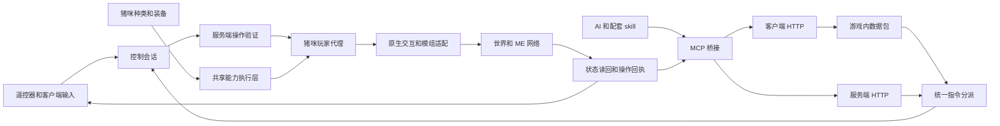

# 猪咪远程工作站实现文档

[文档首页](../README.md)

状态：实现设计，功能尚未实现。目标仓库为 AE2-Lightning-Tech-Reborn。本文面向客户端、服务端及兼容层开发，定义从猪咪激活、第一人称遥控到 AI 作业的完整执行链路。

给猪咪安装过载控制器后，将其激活为拥有独立身份、背包、装备和生命状态的自定义玩家代理。玩家通过遥控器接管代理，AI 通过同一套服务端操作接口接管代理。代理在现场完成维修、搬运和产线施工，操作者本体留在原处。

首个实现基线采用 Minecraft 1.21.1 NeoForge，允许安装配套客户端和服务端桥接 Mod；其他 Minecraft 版本须另行移植验证。本文的类名与协议名凡标为“拟新增”或“建议”的，均为实现接口草案。玩法承诺与建议默认值分别列出。

## 已确定的行为

### 猪咪种类

| 激活对象 | 现有注册 ID | 代理游戏模式 | 自带能力 |
| --- | --- | --- | --- |
| 普通猪咪 | `ae2lt:pigmee_fumo` | 生存模式 | 基础移动、工具、背包、护甲和饰品 |
| 超维猪咪 | `ae2lt:hyperdimensional_pigmee_fumo` | 生存模式 | 自动解锁相位飞行、过载防护 |
| 创造猪咪 | `ae2lt:creative_pigmee_fumo` | 创造模式 | 真正的创造物品栏、创造取物、创造飞行及对应方块操作 |

三种代理共用玩家实体实现，通过种类决定外观、游戏模式和能力来源。激活对象是猪咪 Fumo，不使用原版 `Pig` 作为运行实体，也不以旁边放一个假玩家来替普通猪操作。

超维能力属于代理本体，不占护甲槽或饰品槽，换装后仍然存在。自动解锁表示无需另装模块；相位飞行的启停由操控输入控制。它不自动赋予创造物品权限，也不自动解锁“相位锁定”“多维防护”等其他模块。创造猪咪明确获得创造模式，额外继承超维专属能力不在当前承诺内。

### 操控和装备

- 对放置的猪咪使用过载控制器，激活为代理；遥控器蹲下右键绑定代理，使用遥控器进入第一人称。
- 代理拥有自己的物品栏、主副手、护甲与可选 Curios 饰品库存。装备、工具和物品消耗属于代理。
- 玩家本体与代理是两个独立玩家对象。代理受伤或死亡不把伤害、死亡或掉落转移给操作者。
- 本体仍处于原来的世界位置并正常受到环境影响，不因遥控而自动无敌。建议本体死亡或切换维度时立即退出遥控。
- 代理死亡或连接失效时，关闭代理容器、撤销输入并把视角交还本体。
- 手动遥控和 AI 共用作业能力；每只代理同时只有一个控制者，人工接管优先。
- 三种代理均支持工作期间的周边区块加载，优先复用原生玩家区块票据，避免因附近没有真人或代理跨区块移动而停止作业。
- 代理真正死亡后广播代理名称、所有者、死亡维度和坐标，并保存死亡记录供遥控器及 AI 查询。被防护机制取消的死亡不触发广播。

创造猪咪的创造模式只属于代理。操作者保持原游戏模式，其他猪咪也不会因同一玩家拥有创造猪咪而升级。原版创造模式与管理员权限分别处理，激活创造猪咪不授予 OP 或任意命令执行权限。

### 无人工作站的范围

目标能力包含现场观察、移动、放置与挖掘、工具右键、容器操作、机器配置，以及 AE2 库存查询、请求合成、样板编码和样板安装。核泄漏排障是重点验收场景之一，需在目标危险模组中验证辐射检测、防护和抢修效果。

可扩展到不同整合包，但支持范围以实际覆盖的交互机制和适配器为准。某台机器能显示在界面中，不代表其专用配置、升级或网络协议已经可远控。

### AI 能力前提与接口目标

设计前提是 AI 足够强，能够理解整合包规则、规划产线并分析失败原因。工具层要支撑它在整合包规则下自由组合可行操作；固定产线模板仅用于验收与复用经验，不限定可建造的产线集合。

执行层需要回答三个问题：必要的信息能否获得，玩家可完成的动作能否表达，以及结果能否确认。除机器方块外，接口还应覆盖配方条件、AE2 部件、实体、掉落物、世界环境、红石、等待和持续交互。现场动作统一由猪咪代理承担，仍遵守其种类对应的生存或创造规则。

采用通用观察与原生动作、AE2 结构化操作、按模组适配的配置协议三层。未知机器先使用已覆盖的放置、工具交互和配置卡流程；遇到缺少的专用交互机制时，明确报告所需能力并补适配。可选客户端界面操作作为补充路径，其覆盖范围必须实际验证。

## 现有实现与接入点

以下基于编写时的本地源码快照 `1bda5091` 及当时工作区阅读结果，不能视为远端最新分支的接口承诺。进入功能开发时，重新核对目标分支及依赖版本。源码入口均相对于实现仓库的 `src/main/java/com/moakiee/ae2lt/`；本 `docs` 分支不包含实现源码。

| 现有入口 | 当前行为 | 本功能需要的接入 |
| --- | --- | --- |
| `registry/ModFumos.java` | 注册三种猪咪及其他 Fumo | 精确识别三种猪咪，不让所有 Fumo 自动成为代理 |
| `block/FumoBlock.java` 与 `blockentity/FumoBlockEntity.java` | 装饰方块，空手交互切换旋转 | 控制器交互优先触发激活；保留未激活 Fumo 的旋转等原有功能 |
| `item/FumoBlockItem.java` | 可放置、可戴在头部 | 只有明确的激活操作产生代理，佩戴或普通放置不自动激活 |
| `logic/OverloadBlastFakePlayer.java` | 为爆炸交互提供假玩家身份 | 仅作身份接入参考；它的共享身份及简化生命周期不适合常驻工作站 |
| `celestweave/module/PhaseFlightSubmodule.java` 与 `celestweave/PhaseWingFlight.java` | 基于护甲状态授权与维持飞行 | 拆出可由代理内置能力调用的运行逻辑 |
| `celestweave/service/ArmorCapabilityCollector.java` | 从护甲和已安装模块收集能力 | 引入本体能力来源及合并规则，不制造可拆出的虚拟模块物品 |
| `celestweave/CelestweaveArmorDamageHandler.java` 与 `celestweave/ShieldChargeWindow.java` | 防护判定与护盾结算依赖装备及资源状态 | 共享伤害语义，分离能力来源、运行状态和资源支付方式 |
| `network/PhaseFlightInputPacket.java` | 使用网络上下文中的真实发包玩家 | 增加经过会话验证的代理输入入口，复用输入处理逻辑 |
| `grid/WirelessFrequencyManager.java` | 提供无线 ME 频率解析 | 用于将来的网络接入；频率连接本身不提供摄像机区块同步 |

所检查配置为 Minecraft 1.21.1、NeoForge 21.1.220、Curios 9.5.1+1.21.1。Curios 为可选依赖，缺失时应正常使用基础背包和护甲。

## 玩家使用流程

### 激活和绑定

1. 玩家放置任一种受支持的猪咪。
2. 玩家手持过载控制器使用该猪咪，服务端校验目标、距离、权限和生成空间。
3. 服务端生成带独立身份的代理，将猪咪种类固化为其类型，并完成源方块及控制器的结算。
4. 玩家手持遥控器蹲下右键代理，记录代理标识；绑定不复制代理或其装备。
5. 使用遥控器时，服务端建立控制会话，客户端完成代理状态和附近区块同步后进入第一人称。

建议普通激活消耗一份控制器，把原猪咪转成唯一代理；操作者本身处于创造模式时沿用其正常物品消耗规则。这里的激活成本与后续操控创造猪咪的创造权限是两件事。控制器返还规则见待定项。

激活处理须先于 Fumo 的默认旋转交互完成，并只在服务端执行一次。处理含水猪咪时应保留该位置应有的水状态。客户端预测、双手事件或重复数据包不能各生成一个代理。

### 遥控界面

第一人称显示代理的视角、工具和目标准星。快捷栏、生命、效果、装备与容器内容来自代理；操作者本体出现危险时可以另显提示。界面明确显示代理名称、种类、控制来源及退出入口。

移动输入包含前后左右、跳跃、蹲下、冲刺及视角；动作输入包含攻击或挖掘、使用、切换快捷栏、主副手交换和丢弃。飞行输入遵守代理实际能力。输入均由服务端判定生效，客户端只做预测与显示。

建议使用独立可配置按键退出，普通容器关闭操作只关闭当前容器。打开菜单时停止持续挖掘和残留移动输入。退出后恢复本体视角、快捷栏、HUD 与输入路由，不把代理状态写回本体。

### 失联和回收

失联后清空移动、挖掘和使用意图，暂停作业；不继续重复执行最后一条指令。停止指令输入不表示冻结物理、饥饿或环境伤害。飞行代理可在仍有合法飞行能力时保持悬停，能力失效时按其实际物理状态处理。

会话断开与区块卸载分别处理。断开后先保持可配置的加载宽限期，允许重新连接；宽限期结束且没有被允许继续运行的任务时，保存并停驻代理，撤销对应加载来源。再次连接时，根据持久化位置恢复区块和代理，再建立新会话。区块加载解决世界卸载造成的中断，真实网络断线、服务器停机和授权失效仍按失联规则处理。

首版可只实现退出操控和存档保留。可携带回收是后续独立功能，不能通过普通实体移除顺便实现。若支持回收，回收物必须唯一承载代理身份和库存，并与世界中的活动实体互斥；不得同时掉落全量库存并把同一库存装进回收物。

### 死亡坐标广播

服务端在死亡防护与取消判定结束、代理确认进入死亡结算时，先记录该代理当时的维度和位置，再终止控制、结算掉落并广播。坐标来自代理本体，不能使用操作者位置、摄像机最后缓存、复活点或墓碑的替代位置。

默认向全服在线玩家发送一条工作站死亡消息，建议格式为：

```text
[猪咪工作站] 玩家名的超维猪咪「工程 01」已死亡
维度：minecraft:the_nether  坐标：X=-123 Y=64 Z=456  原因：原生死亡原因
```

显示方块坐标，服务端保留精确位置、死亡时间、原因及唯一死亡事件 ID。维度同时保存注册 ID，避免主世界、下界或自定义维度的同一组坐标混淆；负数坐标按原生方块坐标规则取整。消息可以复制坐标，但不自动执行传送。

死亡广播默认开启，可由明确的工作站广播配置关闭。与该代理原生玩家死亡消息合并或去重，避免同次死亡播报两条；真人的死亡消息保持其原有规则。所有者离线时仍保存记录，重新进入游戏或查看遥控器时可查询最近死亡点。

控制端收到专用的代理死亡通知并退出遥控，不能把代理的原生玩家死亡包原样发给操作者，使其进入本体死亡或重生界面。MCP 通过状态查询获得同一份死亡事件和坐标，所有待执行操作返回 `ACTOR_DEAD`。

卸载、回收、跨维度迁移或普通移除不等于死亡，不广播死亡坐标。死亡事件按 ID 去重；重启后可补查记录，但不重新向全服重播历史死亡，也不因通知失败重复掉落物品。

## 玩家代理运行架构

### 实体和身份

建议新增 `PigmeeServerPlayer extends ServerPlayer`，为每只代理创建独立 `GameProfile` 和 UUID，并明确标识其为自动化代理。所有者 UUID、当前操作者和代理 UUID 分别保存，不复用真实玩家身份，也不为所有猪咪共享一个固定 UUID。

NeoForge 自带 `FakePlayer` 适合模拟有限动作，但在本基线中默认免疫伤害，并将 `tick`、`die` 和 `openMenu` 等置空。常驻代理须具有完整生命周期，不能直接沿用这些空实现。

原型阶段首先验证以下事项，而不是假定实例化 `ServerPlayer` 后自然全部可用：

- 加入和离开世界、实体跟踪、其他客户端显示、玩家信息同步，以及不污染真人登录与退出流程。
- `tick`、玩家专用更新、交互管理器和 NeoForge 玩家事件的实际调用链。每刻只更新一次，不能由世界与自定义管理器重复驱动。
- 无真实客户端时装备、状态效果、Curios 和依赖玩家事件的模组功能是否正常运行。
- 玩家列表、休眠跳夜、刷怪范围、人数统计与区块票据的副作用。代理应有独立策略，不能仅为获得 tick 就无条件走完整真人登录流程。
- `isFakePlayer()` 和相关自动化身份判定应如实表达代理身份；遇到明确拒绝假玩家的功能，通过受支持适配解决。

客户端使用玩家代理的同步表示与自定义猪咪渲染。玩家不是普通可注册生物的等价物；生成与跟踪必须按目标版本实测，不能只注册一个普通 `EntityType` 就宣称玩家生命周期成立。

### 组件职责

拟新增代码集中在 `com.moakiee.ae2lt.workstation` 下，避免把所有行为塞入单个实体类。

| 组件草案 | 职责 |
| --- | --- |
| `PigmeeServerPlayer` | 玩家身体、原生背包、装备、交互和生命状态 |
| `PigmeeActorManager` | 代理创建、加载、卸载、恢复与唯一身份管理 |
| `PigmeeActorStore` | 持久化记录、数据版本和转换恢复 |
| `PigmeeVariant` | 普通、超维、创造三种固定类型映射 |
| `PigmeeAbilityProvider` | 从类型提供本体能力，输出给共享能力执行层 |
| `RemoteControlSessionManager` | 控制租约、人工接管、超时与会话代次 |
| `RemoteViewService` | 摄像机附近区块、实体跟踪及退出恢复 |
| `ActorChunkLoadingService` | 原生玩家加载接入、移动更新、恢复时临时票据及释放 |
| `RemoteMenuBridge` | 代理容器、窗口标识、库存同步与交互转接 |
| `PigmeeDeathReporter` | 死亡位置快照、广播去重、遥控器与 MCP 死亡记录 |
| `ActorActionService` | 手动和 AI 共用的服务端操作入口 |
| `ClientHttpGateway` | 客户端 HTTP、游戏连接转发及客户端界面操作 |
| `ServerHttpGateway` | 服务端 HTTP、凭据解析与无人值守请求入口 |
| `ActorCommandDispatcher` | 两条路径共用的授权、租约、请求去重与任务分派 |
| `MachineOperationAdapter` | 模组配置与特殊操作的有限适配接口 |
| `WorkstationMcpBridge` | 将作业接口映射为 MCP 工具，不直接访问可变世界对象 |

能力与指令流为：



### 物理和渲染

外观采用对应猪咪的模型和材质。实体尺寸、眼高、蹲伏、游泳、飞行姿态、拾取范围和触及距离须成套定义，服务端碰撞与客户端视线使用同一套参数。建议原型先采用玩家尺寸证明遥控链路，再调整到最终猪咪尺寸；不能只缩小模型而保留不符合显示的交互位置。

装备效果与装备显示分开验收。护甲、饰品和手持物需要猪咪模型的挂点或专用渲染层；模组提供的人形渲染器不能直接视为已适配。第一人称隐藏自身会遮挡视线的部分，同时保留必要的工具显示。

## 能力来源与三种游戏模式

### 共享运行逻辑

将现有逻辑分为能力来源、有效能力解析、运行状态和执行四层。装备模块继续提供装备能力，猪咪种类提供内置能力；有效能力解析负责同类能力优先级和去重。

运行状态必须以代理为主体保存。相位飞行输入、飞行速度、穿行状态、防护窗口和伤害结算不能只存在于一件虚构护甲的 `ItemStack` 中。原装备路径可以用适配器继续读写其既有数据，保证真人装备行为不被此次重构改变。

当代理同时具备内置能力和同类装备能力时，只应用一次最终运动或防护效果。支付由所选能力来源承担，避免既扣装备能量又扣代理资源。切换来源时应正确保留或终止持续状态，不能靠换装重复获得护盾支付额度。

### 超维猪咪

出生后即可使用相位飞行和过载防护，不需要穿指定护甲。飞行启停、速度、惯性与穿行策略尽量沿用现有可解释配置；过载防护复用原有伤害分类、优先级和死亡仲裁语义。

当前护甲实现包含 FE 和闪电成本、护盾结算窗口等状态。“自动解锁”尚未规定内置能力是否免耗能。实现需要显式的资源策略，例如自持能力或代理资源储备，不能把能力来源缺少护甲误判成无限能量，也不能因护甲为空导致能力永远不可用。该选择在能力阶段定稿。

过载防护不能仅用常量 `isInvulnerableTo = true` 替代。辐射剂量、负面效果和直接死亡等机制须按照目标模组及现有防护能力验证，区分“拦截伤害”“阻止污染累积”和“清除已有污染”。

### 创造猪咪

服务端根据代理的可信种类设置 `GameType.CREATIVE`，并提供针对代理的创造物品栏与创造取物入口。玩家本体即使处于生存模式，也能通过有权限的创造猪咪执行其合法创造操作。

创造物品操作必须定位到代理库存并验证代理的真实游戏模式。客户端提交的种类、游戏模式或物品数量不能直接改变普通或超维代理。创造猪咪产生的物品仍按创造模式预期参与世界，不额外引入未经确定的“禁止给生存玩家使用”规则。

创造模式遵守原生语义和服务器权限，包括原生不覆盖的伤害、移除及模组特例。不能把创造模式描述为对所有模组的绝对不死，也不能由此开放任意方块 NBT 写入或管理员工具权限。

## 遥控会话和网络同步

### 控制状态

建议会话状态使用 `IDLE`、`MANUAL`、`AI` 和 `SUSPENDED`；代理加载、存活和回收状态与控制状态分别表示。

| 触发条件 | 服务端动作 |
| --- | --- |
| 成功开始手动遥控 | 建立租约，准备视图和库存；客户端确认就绪后接受输入 |
| 人工接管 AI | 提升会话代次，暂停 AI，丢弃旧代次的待执行指令 |
| 客户端退出或连接超时 | 清空输入、关闭容器、释放视图资源，进入加载宽限期；任务和加载按各自策略保留或暂停 |
| 代理确认死亡 | 记录死亡维度和坐标，终止控制与任务，执行一次死亡结算与广播，再释放加载来源 |
| 代理卸载或回收 | 保存状态，终止控制并释放加载来源；不触发死亡广播 |
| 操作者死亡或跨维度 | 首版结束遥控，恢复本体正常生命周期 |
| 服务器重启 | 恢复代理数据，控制租约失效；旧请求不能直接恢复为执行中 |

每条输入携带代理 ID、会话 ID、会话代次和递增序号。服务端验证当前控制者后才处理；旧输入、重放输入以及跨代理伪造均拒绝。连续按键带有短期有效性，停止收到更新后不能一直前进或挖掘。

### 远程视图

设置摄像机只改变观察对象，不足以解决远处区块、实体跟踪、目标射线和物品栏同步。首版建议限定同维度，先证明操作者与代理相距超过正常视距时仍能操作。

需要同时维护本体的正常服务端状态与代理观察位置的客户端数据。视图服务负责代理附近的客户端区块订阅与实体更新，加载服务负责服务端区块的存在和 tick。客户端收到代理所需区块前不开放交互；无效或未加载目标返回明确状态，不能当作空气继续施工。

已核对的 `ServerPlayer.setCamera()` 会将该玩家传送到摄像机实体位置，后续 `ServerPlayer.tick()` 还会跟随该实体移动。遥控不能直接对操作者调用这条服务端旁观路径，否则本体也会进入事故现场。应由远程视图桥接改变客户端观察上下文，并保持服务端本体的位置独立。

区块订阅与服务端加载分别设预算。退出遥控只立即释放该视图订阅，仍在合法作业的代理继续保有加载能力。跨维度观察需要独立处理客户端世界上下文，在同维度链路通过后单独实现。

本体与代理的 HUD、射线、音效来源和活动容器需要显式的 `RemoteActorContext`。不能把更换 `Minecraft.player` 引用当作完整方案；任何确需切换上下文的兼容代码都应有进入、异常退出与恢复测试。

### 原生玩家区块加载链路

本节依据 Minecraft 1.21.1、NeoForge 21.1.220 的映射及补丁后源码。玩家自身提供加载来源，但需要实际进入世界跟踪并持续更新位置，单独构造一个 `ServerPlayer` 或工具用 `FakePlayer` 不会自动完成这些步骤。

| 环节 | 实际入口与行为 |
| --- | --- |
| 加入世界 | `ServerLevel.addNewPlayer()` 经实体管理器触发 `EntityCallbacks.onTrackingStart()`，再进入 `ServerChunkCache.addEntity()` 和 `ChunkMap.addEntity()` |
| 建立玩家加载来源 | `ChunkMap.addEntity()` 对 `ServerPlayer` 调用 `updatePlayerStatus(player, true)`；未被跳过时进入 `DistanceManager.addPlayer()` |
| 创建票据 | `DistanceManager.addPlayer()` 更新玩家加载距离追踪器，同时给 tick 距离追踪器加入 `TicketType.PLAYER`；模拟距离参与实体 tick 级别计算 |
| 玩家移动 | 原生移动处理调用 `ServerChunkCache.move(player)`，进入 `ChunkMap.move()`；所在 section 改变时移除旧位置来源并加入新位置来源 |
| 客户端视图 | `ChunkMap.updateChunkTracking()` 根据玩家位置及视距计算 `ChunkTrackingView`，变更进入该玩家连接的 `PlayerChunkSender` |
| 区块发送 | `MinecraftServer` 遍历全局 `PlayerList`，调用各连接的 `chunkSender.sendNextChunks()`；发送还受客户端批次确认限制 |
| 离开世界 | `ChunkMap.removeEntity()` 调用 `updatePlayerStatus(player, false)`，撤销对应玩家加载来源和视图 |

上述加载资格检查使用玩家类型和旁观规则；这条链路没有统一按 `isFakePlayer()` 排除代理。`Player.isAlwaysTicking()` 也返回真，但自身 tick 与周边区块加载是两件事。旁观模式且 `spectatorsGenerateChunks` 关闭时会被跳过，因此不能用把猪咪切成旁观模式的方式实现相位能力。

世界内玩家集合、区块跟踪用玩家集合与全局 `PlayerList` 并非同一个集合。代理进入前两者可以成为服务端加载来源，却不代表已经具备真人连接的区块发送和确认流程。无客户端的 AI 代理只需要世界加载与运行；有人遥控时，视图桥接向操作者传送远程数据，管理批次确认和队列。不能将区块包丢进假连接后任其无限堆积，也不能把发送成功假定为客户端已经收到。

服务端自驱动移动和 AI 寻路完成位置更新后，须接入原生 `getChunkSource().move(actor)` 等位置同步流程，避免玩家票据停留在旧区块。原生加载范围受服务器视距和模拟距离等规则影响，并不天然等于固定的 3 × 3；多个代理的成本应按实际范围压测。

### 加载策略与释放

首选策略是复用正常玩家票据，不再为同一活动范围叠加一套常驻强制加载。若未来需要更小的独立作业半径，应实现明确的替代策略与原生加载隔离，单纯再加一个小范围票据不会缩小已有玩家加载范围。

| 生命周期 | 加载处理 |
| --- | --- |
| 手动遥控或 AI 作业中 | 保持代理在世界跟踪中，按其移动更新原生玩家加载来源 |
| 真人暂时失联 | 清空输入并暂停对应任务，在配置宽限期内保留代理和原生加载来源 |
| 无控制且无任务，宽限期结束 | 保存并停驻代理，通过正常移除路径撤销玩家来源；不只停止自定义任务而留下活跃玩家对象 |
| 重新连接或重启恢复 | 先按持久化位置确保启动区块可用，恢复代理并确认原生加载生效，再撤销启动用临时票据 |
| 确认死亡或回收完成 | 完成状态、库存与死亡记录结算后移除玩家来源，清理本代理的临时票据 |
| 将来跨维度迁移 | 目标区块可用后完成玩家世界迁移，确保旧维度来源释放、新维度来源建立 |

恢复前尚无活动玩家实体、或实现阶段确需短时保活时，可以使用注册的 NeoForge `TicketController`，以稳定代理 UUID 作为票据所有者。需要完整世界 tick 的区域使用其 `ticking` 语义；保存恢复回调依据代理记录验证票据，避免仅因玩家对象尚未重建而误删有效启动票据。重建失败或超时必须释放临时票据。

区块边界移动、快速飞行和传送要验证目标区块已经就绪再进入。加载不足时等待并返回可观察的状态，不能先让代理进入未加载区再靠失联恢复补救。临时票据、原生玩家来源和客户端视图订阅各自维护生命周期；清理一只代理不能移除另一只代理或真人仍在使用的来源。

### 容器和专用数据包

服务端菜单以代理为操作玩家，距离检查以代理的位置为准。客户端菜单使用代理的镜像库存，操作者自己的库存始终独立。桥接层维护客户端窗口与服务端代理菜单的对应关系，校验菜单状态版本、槽位和光标物品。

退出、死亡或断线时，光标物品按菜单正常关闭语义结算一次；不可既返还给代理又返还给操作者。延迟到达的旧窗口点击必须失效。

第三方 GUI 可能读取本地玩家，也可能发送以 `context.player()` 为主体的自定义包。不能把这些包原样转发就假定操作了代理。适配器需明确恢复代理上下文、目标菜单和权限，并调用该模组的正常配置入口；未适配功能应返回不支持，保留已可用的基础容器操作。

可选的客户端辅助接口可提供当前代理界面的槽位、按钮、文本框、分页和截图，再执行普通点击、拖动、输入或按键。它必须与同一代理会话绑定，保留菜单身份及服务端校验。该功能需要实际客户端界面运行；纯服务端 AI 模式应报告其不可用，不能承诺任意未知 GUI 均已可操作。

## 作业接口和资源规则

所有世界修改在服务器主线程执行。输入处理先验证请求，再执行一次原生操作，最后读取权威状态生成结果。网络线程或 MCP 线程只解析和排队，不直接持有并修改世界对象。

统一校验包含当前控制租约、代理存活与加载状态、目标维度和位置、触及距离、视线或该工具允许的交互方式、领地与所有者授权、物品与能力条件。飞行和相位穿行并不自动增加交互距离或授予隔墙使用权限。

| 操作 | 执行语义 | 主要验证 |
| --- | --- | --- |
| 移动和寻路 | 游戏内运动或有预算的寻路任务 | 速度、碰撞、可用飞行、目标是否可达 |
| 放置 | 从代理选定槽位调用原生物品使用流程 | 材料、命中面、朝向、距离和放置权限 |
| 挖掘 | 沿用游戏模式、工具、破坏进度和掉落流程 | 硬度、挖掘距离、工具与取消事件 |
| 右键或工具使用 | 沿用正常交互顺序与模组事件 | 主副手、蹲下、目标类型和原生返回值 |
| 容器转移 | 对真实槽位执行提取和插入 | 当前菜单、库存版本、容量及双方规则 |
| 机器配置 | 适配器执行受支持字段的原生操作 | 字段类型、取值、前置条件和读回结果 |
| 创造取物 | 进入代理的合法创造操作路径 | 代理实际为创造种类及创造模式 |

普通和超维猪咪必须真实消耗材料、工具耐久及适用资源。创造猪咪按原生创造规则执行。两类模式都不得通过通用接口替换机器库存、能量、加工进度或任意方块 NBT。

允许读取授权范围内的状态和 NBT，优先返回稳定的语义字段。配置操作可以由 AI 构造结构化请求，经服务端验证后执行。NBT 观察不等于写入权限，也不等于能读取任意未加载位置或无限范围内的机器。

### 目标定位和基础交互

世界目标使用明确的种类及标识：方块为维度和坐标，AE2 部件还需部件所在面或已解析的中心部件位置，实体使用实体 UUID。读取整块方块与读取某个部件的配置必须区分，不能把同一坐标上的总线、面板和线缆当成一个目标。

一次持物交互包含目标、点击面、命中点、使用哪只手、选中槽位、是否潜行，以及必要的视角或放置朝向。手持物以服务端代理槽位为准，请求不能凭空声明工具。把“左键点按”“开始并维持挖掘”“停止挖掘”和“持续使用物品”分别表达，并支持主动取消。

AI 可以选择“旋转到某方向”之类语义操作，也可以组合基础扳手交互。语义操作必须通过已验证的原生动作实现；完成后读回朝向和部件身份，不能只凭调用返回成功认定目标已经正确配置。

## 可编辑配置包

配置包保存目标参数和应用流程，适配器定义哪些参数可修改以及如何执行。两者按机器家族和交互机制复用；AI 可以自行构造合法参数组合，也可以把验证成功的组合保存为模板。

支持两种应用方式：已有配置卡保存的机器设置可以通过该模组的原生流程复制到兼容目标；需要自行设计配置时，由适配器公布可编辑字段，AI 填写参数后提交配置请求。原生数据包适配同样保留玩家身份、菜单会话和目标检查，不提供任意数据包无条件转发入口。

| 配置包字段 | 作用 |
| --- | --- |
| 包版本与适配器 ID | 确定协议、迁移方式和实际执行逻辑 |
| Mod 版本及目标机器族 | 判断目标是否兼容，版本不符时拒绝或进入明确迁移流程 |
| 参数定义与允许值 | 公布类型、范围、枚举、默认值及字段之间的约束 |
| 朝向规则 | 区分世界方向与机器相对方向，将前后左右映射到实际朝向 |
| 工具与真实材料要求 | 声明配置卡、工具、升级卡等前置条件 |
| 操作步骤与后置条件 | 按需拆分请求，并指出要读回哪些字段确认生效 |

只允许编辑适配器明确支持的配置字段。对于未解释字段的原生配置卡，可保留其合法生成的数据并执行正常应用流程，但不把整段数据合并回方块 NBT，也不允许随意修改其中的真实物品槽位。

过滤器中的物品描述与真实库存分别处理：设定“过滤铁锭”只改变匹配规则；安装升级卡必须转移真实升级卡；取出物品必须从实际库存扣除。创造猪咪通过明确的创造物品操作取得资源，也不把配置协议变成库存赋值接口。

应用配置后返回每一步的实际结果、缺少的升级或资源、未生效字段及新的目标状态。跨多步应用可能部分完成，超时后先查询回执和读回结果，再决定继续哪一步；不得把重复应用视为天然无副作用。

## AI 的两条 HTTP 操控路径

提供客户端 HTTP 和服务端 HTTP 两个入口，核心操作共享相同请求模型、代理身份规则、控制租约和服务端执行器。HTTP 是外部调用入口，游戏数据包是客户端到服务器的传输方式，MCP 则在外层将这些操作包装为工具。

| 项目 | 客户端 HTTP | 服务端 HTTP |
| --- | --- | --- |
| 链路 | AI → 客户端 HTTP → 已登录的游戏连接 → 服务端分派器 | AI → 服务端 HTTP → 服务端分派器 |
| 运行条件 | 游戏客户端已连接目标服务器，双方有工作站功能 | 服务端运行并允许该 API 身份执行代理任务 |
| 授权依据 | 已认证的游戏连接身份，再检查其对代理的控制权 | 服务端签发凭据对应的主体、代理范围与操作权限 |
| 主要用途 | 本地 AI 辅助、可视遥控、客户端界面与截图 | 无客户端的持续作业、远程任务和状态查询 |
| 界面能力 | 当前代理界面的读取和操作，按实际适配公布 | 支持服务端菜单逻辑和结构化操作，不提供真实客户端画面 |
| 失联处理 | 游戏断开后撤销该连接的租约，旧世界请求失效 | 按任务租约及离线策略暂停或继续，HTTP 连接关闭不等于取消任务 |

### 客户端 HTTP 到游戏数据包

HTTP 工作线程解析请求后，把连接检查、菜单访问和发包提交到客户端主线程。服务端权威查询与修改通过拟新增的 `WorkstationCommandPayload` 发送，服务端返回带相同请求 ID 的结果或任务事件。客户端只把“已发送”报告为传输状态，不能据此报告执行成功。

服务端从网络上下文取得真实发起玩家，验证其租约与代理授权，再解析请求中的代理 ID。原生数据包的发送者不会因为 JSON 中填写了代理 UUID 而改变。现有 `WirelessConnectorUsePacket`、`PhaseFlightInputPacket` 等直接使用 `context.player()` 的处理方式，需要拆出接受已验证代理上下文的业务方法；不能直接复用它们来操作本体之外的实体。

普通界面点击可以沿用游戏的原生数据包，但仍需前述代理菜单桥接。特殊模组包按适配器转换；不提供任意字节包注入接口。无法关联权威回执的原生 UI 动作，超时后必须读回现场状态，不能因为没收到 HTTP 响应就再次点击。

客户端 HTTP 不要求服务器再开放 HTTP 端口，但完整代理功能和只读 NBT 查询仍需要服务端工作站支持。客户端缓存只含已同步的数据；读取完整授权状态应走查询数据包，不能把未同步字段当成空值。核心结构化操作无需强制打开第一人称画面，只有 UI 与截图能力要求对应客户端上下文就绪。

切换服务器、退出存档或重新连接时递增连接代次，清理待发送命令和旧订阅。请求还需绑定服务器及世界标识，避免上一世界排队的指令在下一世界执行。

### 服务端 HTTP 直接分派

服务端 HTTP 工作线程验证凭据并解析有界请求，随后通过服务器主线程调度进入 `ActorCommandDispatcher`。权限、距离、材料、游戏模式、菜单及目标状态检查与客户端路径一致；执行仍调用原生交互或明确适配器。

此路径没有真实连接提供 `context.player()`，由凭据映射到授权主体，再选择获准控制的猪咪玩家实体。请求中的所有者或玩家 UUID 仅是目标信息，不能作为身份证明；凭据也不直接转换为 OP 权限。允许的任务可以在所有者离线、没有渲染客户端时运行，仍受服务器离线策略和区块加载规则约束。

服务端入口调用共享业务层，不伪造 `IPayloadContext` 再调用网络包处理器。依赖菜单的操作建立属于代理的合法服务端菜单会话；依赖客户端 GUI 的操作返回 `CLIENT_REQUIRED` 或 `UNSUPPORTED_OPERATION`，由调用方选择客户端路径或补充适配。

### 统一 HTTP 合约

建议两个入口使用相同 `/api/v1` 路径和 JSON 数据模型，客户端专属能力通过发现接口声明。

| 方法与路径草案 | 语义 |
| --- | --- |
| `GET /capabilities` | 返回入口类型、协议版本、服务器和世界标识、可用操作及客户端连接状态 |
| `GET /actors` 与 `GET /actors/{id}` | 查询授权代理、加载状态、能力及死亡坐标 |
| `POST /actors/{id}/sessions` | 取得 AI 控制租约；不抢占人工控制 |
| `DELETE /sessions/{id}` | 释放租约并处理残留输入 |
| `POST /actors/{id}/commands` | 提交带会话代次、请求 ID 和目标版本的操作 |
| `GET /requests/{id}` 与 `GET /tasks/{id}` | 查询权威受理状态、执行进度和完成结果 |
| `POST /tasks/{id}/cancel` | 请求取消，返回实际取消结果与已完成部分 |
| `GET /events` | 可选 SSE 事件流，推送任务、租约、加载和死亡事件 |

查询世界状态也应在主线程取得快照，再由 HTTP 线程编码返回。长操作立即返回任务句柄，不能阻塞游戏主线程等待 HTTP、网络或模型响应。HTTP `202` 只表示接受处理；客户端入口尚未获得服务端确认时，应明确返回本地转发状态，不能冒充服务端已受理。

两条路径共用服务端请求账本。去重至少绑定授权主体、代理、会话代次与请求 ID，并核对请求内容；不能各自维护一份“已执行”记录。切换路径前先确认服务器、世界、任务与当前租约，查询原请求状态。原生 UI 动作无法确认结果时返回未知状态，不自动改走另一路径重放。

AI 控制租约包含具体控制者，不能只按所有者共享。即使客户端和服务端使用同一所有者授权，也不能同时驱动一只代理。路径切换须显式转移租约并提升代次，旧请求随后失效；人工接管仍优先。

轮询作为基本完成通知方式，SSE 可减少重复查询。事件携带事件 ID，断流重连可在有限保留窗口内补取；事件过期时重新查询权威状态，不能把漏收事件认定为任务未执行。死亡广播与 API 死亡事件使用同一份持久化记录。

### 线程与入口生命周期

两个入口均需配置启用，默认绑定回环地址并要求访问令牌。客户端令牌只授权使用该客户端，服务端令牌独立管理并限定代理与操作范围。外部访问通过显式配置和受保护连接开放；不使用无认证的公开监听或任意跨域请求。

限制 HTTP 请求体、并发、任务队列和订阅数量。客户端到服务端的自定义 payload 受该版本数据包大小限制，批量施工、配方和 NBT 查询采用分页或有界分段；不能把无限 JSON 直接塞进单个游戏包。

HTTP 回调不能直接访问可变世界或 GUI，游戏线程也不能同步等待 HTTP future。专用服务器不得加载客户端 GUI 类。单人游戏中逻辑客户端与内置服务器仍按两个入口处理，使用独立端口配置并共享同一服务端指令账本，避免双重执行。

客户端关闭或服务器停止时关闭监听、订阅和待处理 future；完成必要状态保存。HTTP 传输断开不自动回滚已完成游戏操作。绑定端口冲突时停用该入口并给出明确状态，不影响正常游戏启动。

## MCP 和配套 skill

### 工具集合

MCP 工具包装上述 HTTP 作业接口，通过配置选择客户端或服务端地址，操作语义保持一致。先查询能力，再取得租约和提交指令；不能因某条路径超时就自动向另一条路径重复提交修改。

普通 JSON HTTP API 本身不等于 MCP。建议先交付两个 HTTP 网关，再由轻量 MCP 适配器提供标准工具协议；skill 描述操作流程和失败恢复。需要直接暴露 MCP HTTP 时，应另外实现对应 MCP 传输规范，不混用业务事件流与 MCP 协议。

| 拟提供工具 | 用途 |
| --- | --- |
| `pigmee.list` 与 `pigmee.status` | 列出有权访问的代理、种类、模式、控制与加载状态、能力及最近死亡记录 |
| `pigmee.acquire` 与 `pigmee.release` | 获取或释放 AI 控制租约 |
| `pigmee.observe` | 读取附近目标、库存及支持的操作，分页返回 |
| `recipes.query` 与 `recipes.inspect` | 查询运行时配方、输入输出与已知机器条件，标识数据来源和未覆盖条件 |
| `pigmee.move_to` 与 `pigmee.stop` | 提交有边界的寻路任务或停止动作 |
| `pigmee.select_slot` 与 `pigmee.interact` | 选择工具并执行原生交互 |
| `pigmee.place` 与 `pigmee.break` | 放置或挖掘，返回任务或执行回执 |
| `pigmee.interact_entity` 与 `pigmee.use_item` | 与实体交互、使用或持续使用手中物品，遵守代理动作条件 |
| `pigmee.transfer` | 在合法容器间转移真实物品 |
| `pigmee.configure` | 调用已公布的机器配置操作 |
| `configuration.describe` 与 `configuration.apply` | 查询适配协议、应用原生卡片或可编辑配置包 |
| `pigmee.ui_inspect` 与 `pigmee.ui_action` | 可选客户端辅助接口，读取并操作当前代理界面；无可用客户端时明确返回不可用 |
| `pigmee.task_status` 与 `pigmee.cancel` | 查看、取消长任务 |
| `ae2.inventory` 与 `ae2.transfer` | 查询可访问 ME 库存，合法存入或取出物品 |
| `ae2.craft_manual` | 操作合成终端工作台网格，结算实际输入、产物和返还物 |
| `ae2.plan_craft` 与 `ae2.craft` | 预览自动合成的资源与缺料，再提交合成任务 |
| `ae2.encode_pattern` | 编码真实样板，保留配方身份和样板类型 |
| `ae2.pattern_providers`、`ae2.install_pattern` 与 `ae2.remove_pattern` | 查询供应器，安装或取回真实样板 |

观察结果同时返回 `supported_operations`，每个操作声明参数类型、合法取值、资源要求、权限与验证字段。适配按机器家族或交互机制复用，不按每条产线硬编码。

### 请求和回执

下面是拟议的机器配置请求。坐标与操作名仅作协议示例，不代表现有机器已经实现该适配器。

```json
{
  "protocol_version": 1,
  "request_id": "operation-0001",
  "actor_id": "actor-uuid",
  "session_id": "session-id",
  "generation": 3,
  "expected_revision": 42,
  "target": {
    "dimension": "minecraft:overworld",
    "pos": [120, 64, -32]
  },
  "operation": "machine.set_side_mode",
  "parameters": {
    "resource": "item",
    "side": "north",
    "mode": "input"
  }
}
```

`expected_revision` 指服务端观察接口为该目标签发的状态版本；无法取得原生版本时，适配器在执行前重新核对必要的前置状态。请求 ID 在当前会话中用于去重，同一 ID 携带不同内容应拒绝。明确限制回执保留窗口，过期或重启后状态不明的修改请求不得自动重放。

回执包含请求 ID、结果状态、失败原因、目标新版本、实际资源变化，以及长任务 ID。只有读回验证达到后置条件才返回完成；进入队列返回接受，挖掘或移动中返回运行中。已产生部分世界变化的任务取消，应报告完成部分，不承诺回滚所有外部模组行为。

建议错误码包含 `NO_CONTROL`、`STALE_SESSION`、`STALE_STATE`、`OUT_OF_REACH`、`UNLOADED_TARGET`、`UNSUPPORTED_OPERATION`、`INSUFFICIENT_ITEMS`、`TARGET_CHANGED` 和 `ACTOR_DEAD`。

### skill 的职责

配套 skill 描述如何发现能力、观察现场、制定方案、执行操作和验证结果。它不绕过服务端权限，也不凭说明文字提供游戏控制能力。建议首批流程为设备停机排查、管线修复、AE2 供料链搭建和产出验收。

例如辐射抢修先读取危害与代理能力，再检查目标机器与管线，执行支持的隔离或维修操作，最后确认机器状态和污染趋势。支持范围不足时报告缺少的操作；不能把“关停反应堆”解释为“现场辐射已经消失”。

AI 以目标和有边界的任务驱动代理，寻路、按键维持及挖掘进度由游戏执行。无需模型逐 tick 发按键。真人接管后，旧 AI 任务保留诊断信息并暂停，不能因 AI 迟到的下一次调用夺回控制。

## AE2 和第三方兼容

AE2 网络访问需具备实际连接条件与授权。初版可以先操作现场终端；无线 ME 接入再复用既有频率规则。终端可访问性与现场方块交互范围分别校验。

### 三种终端的操作范围

这里的三种终端是合成终端、样板编码终端和样板管理或访问终端，普通存储操作包含在合成终端的能力中。

| 终端 | 需要提供的操作 | 完成判定 |
| --- | --- | --- |
| 合成终端 | 查询、存入和取出；手动合成；自动合成预览、下单和任务查询 | 实际库存与返还物正确；自动合成能区分缺料、CPU 忙、提交和完成 |
| 样板编码终端 | 查询当前配方、填写输入输出、选择样板类型、编码 | 精确配方及组件信息保留；生存操作消耗空白样板；得到目标可接受的真实样板 |
| 样板管理或访问终端 | 枚举可访问供应器、查询已安装样板、安装和取回 | 目标库存实际变化；样板格式、容量及目标机器条件满足 |

已有样板的材料展开和自动合成调度交给实际 AE2 合成系统，AI 负责提出目标、分析缺料、补充样板和建设缺失机器。手动合成与自动合成订单分别实现，不能用一次库存增减代替合成网格或原生任务。

### 配方与世界机制

配方查询以当前整合包运行时状态为准，包含数据包和脚本最终生效的改动。返回配方标识、类型、输入输出、数量、组件或 NBT 匹配约束，以及已知的机器、模具、温度、流体或多方块条件。只有界面展示数据或未知条件时，应明确数据来源与尚未验证的部分。

样板内容不能独自证明机器可执行。AI 需要观察供能、频道、连接、输入输出面、模具、结构和阻塞状态，并通过实际试生产确认。生物交互、掉落物转化、环境和红石条件可通过基础世界操作与观察组合，不要求把所有机制伪装成普通机器配方。

### 接入约束

- 库存查询采用分页与按需筛选，避免每只代理持续枚举整个 ME 网络。
- 请求合成区分计算计划、缺料、提交成功和最终完成，保留任务标识，不因工具重试重复下单。
- 样板编码消耗实际空白样板；创造代理按创造语义处理材料来源。安装样板走供应器或样板管理的合法入口，不能替换整个方块 NBT。
- 兼容原版 AE2、TB 与天枢时分别验证实际入口和结果；一种 CPU 路径通过不代表全部通过。
- Curios 的库存挂载、每 tick 效果、装备条件、卸下回调、死亡规则和数据恢复分别验证；不存在 Curios 时不加载其类。
- 防辐射套装、喷气背包等玩家装备，要验证效果触发与资源消耗。依赖真实客户端或明确禁止假玩家的机制列入适配范围。
- 领地保护与行为归属应同时保留代理身份、所有者和实际控制来源，不通过伪造真人 UUID 获得权限。

AE2 菜单类、样板容器及原生配置卡接口集中在版本适配层。能枚举 `PatternContainer` 仅代表发现了样板目标，仍需验证该目标认可的格式、机器状态和原生插入路径。AE2 记忆卡和其他模组配置卡各按自己的协议适配，不推定其字段可以通用互换。

## 持久化和唯一结算

`ServerPlayer` 不能按普通生物的区块保存流程直接假定可恢复。建议由代理管理器保存带版本的记录，运行时玩家对象是这份记录的活动承载者；避免同时用自定义保存和真人 `playerdata` 各恢复一份实体。

| 数据 | 保存要求 |
| --- | --- |
| 代理身份 | 稳定代理 ID、Profile UUID、类型、所有者和显示名称 |
| 世界状态 | 维度、位置、朝向、生命周期状态和数据版本 |
| 玩家状态 | 背包、主副手、护甲、生命、饥饿、效果及所需玩家数据 |
| 扩展状态 | Curios 和适配模组通过各自受支持序列化保存的数据 |
| 内置能力 | 配置、运行状态及已确定资源策略要求的数据 |
| 转换与结算 | 激活或回收操作 ID、状态、死亡结算标记 |
| 死亡记录 | 唯一事件 ID、代理和所有者、死亡维度、精确位置、显示坐标、原因、时间及广播状态 |
| 加载恢复 | 加载策略、停驻或活动状态、恢复所需位置和临时票据归属；不盲目恢复旧控制租约 |
| 作业记录 | 可供诊断的任务状态和已完成步骤；重启后不自动重放不明修改 |

活动时库存只有代理持有的一份权威可变实例。保存快照、客户端镜像及 MCP 观察结果不可作为第二份可花费库存。

激活、回收和死亡是需要唯一结算的转换。服务端使用操作标识及状态迁移记录，防止重复输入；恢复时检查源猪咪、代理记录和结算结果是否一致。服务器主线程上的一次调用不等于多个存档文件之间具有原子提交，必须用故障注入验证中断恢复。

恢复遇到无法判定是否已扣物或已掉落的记录时，暂停该代理并保留诊断数据，不能同时补发控制器、猪咪和全量库存。管理员恢复属于独立管理入口，不属于 AI 通用作业接口。

死亡结算沿用已选定的玩家掉落和装备规则，处理 Curios、墓碑类模组与 `keepInventory` 的相互作用。具体猪咪本体及控制器是否掉落见待定项；无论选择哪种规则，操作者本体的库存都不参与结算。

## 性能与服务器运行

- 玩家物理仍按服务器 tick 更新；状态观察采用按需快照和增量更新，不对每只代理每刻序列化完整 NBT。
- 每只代理及全服分别限制活动寻路、世界操作、待处理请求和区块票据。寻路必须可取消并分步消耗预算。
- 实体和目标查找限定在授权且已加载范围，ME 查询按请求执行；不为每只代理创建全网持续监听器。
- 网络和 MCP 操作使用有界队列。队列已满时返回可重试状态，不能无限积压。
- 长任务在目标变更、资源不足和区块不可用时等待或暂停；重试由具体条件变化触发，并有预算，避免无效循环。
- 无人作业不要求客户端保持渲染；被允许继续作业的代理保有原生玩家加载来源。所有者离线是否允许任务继续、宽限期和并发上限作为显式服务器策略实现。
- 加载票据不能让已经停机或暂停世界 tick 的服务器继续运行。长期保活也需评估玩家刷怪、睡眠和服务器空闲策略的副作用。

具体并发和带宽上限通过实际服务器压测定稿；首版需记录每代理 tick 开销、寻路耗时、队列长度、加载区块数和同步字节量。

## 分阶段实现与验收

| 阶段 | 交付内容 | 通过条件 |
| --- | --- | --- |
| P0 玩家代理原型 | 独立身份、世界加入与移除、玩家 tick、原生区块加载、背包、伤害、保存恢复 | 无真人在附近也能更新和跨区块移动；停止后加载来源正确释放；两个代理状态独立；重启不重复生成 |
| P1 猪咪激活与外观 | 三种 Fumo 转换、遥控器绑定、类型同步、猪咪模型 | 激活只结算一次；普通 Fumo 原行为正常；三种类型保存后不变 |
| P2 第一人称遥控 | 同维度远程视图、输入、HUD、加载恢复与死亡坐标广播 | 超出本体视距仍可见和移动，本体位置不变；失联宽限和重连有效；真实死亡正确广播维度和坐标；双控制者无法同时驱动 |
| P3 现场交互 | 放置、挖掘、工具、基础容器、代理创造物品栏 | 生存消耗准确；容器无跨背包串物；创造猪咪可合法创造取物，本体保持原模式 |
| P4 超维能力与装备 | 内置相位飞行和过载防护、资源策略、护甲与 Curios | 无装备时能力可用；同类能力去重；换装、退出、重启不丢状态；真人装备回归通过 |
| P5 AE2 与机器适配 | 三种终端、配方查询、按面施工、首批可编辑配置包 | 从真实资源完成一条小型产线并确认产物回网；配置朝向正确；特殊 GUI 或不支持操作准确报告 |
| P6a 双 HTTP 入口 | 共享分派器、客户端游戏包通路、服务端直连、身份与租约 | 两条路径对同一操作给出等价结果；无客户端可完成服务端任务；切换入口不重复执行 |
| P6b MCP 与 skill | HTTP 适配、工具协议、任务查询、无人执行流程 | AI 完成观察到结果验证的闭环；人工接管立即生效；重试不重复扣物或下单 |
| P7 后续扩展 | 跨维度、回收、更多危险模组和机器协议 | 分别满足世界切换、唯一保存及目标模组原生语义测试 |

P0 是继续推进的技术门槛。玩家 tick、独立库存或存档恢复尚未成立时，不应靠展示一个会移动的猪咪模型宣称工作站已可用。

### 首条无人产线验收

在已有供电的 ME 网络旁指定一块施工区域，提供普通或超维猪咪及必要材料。由 AI 查询当前整合包可用的电力熔炉配方，完成以下流程：

1. 查询网络库存和配方条件，取得工具、机器、线缆、供应器及空白样板；必要时通过终端手动合成或原生自动合成补料。
2. 移动到施工区，放置机器和 AE2 部件，按目标面接通网络、供能与物流。
3. 应用可编辑配置包或原生配置卡，设置输入输出，并读回旋转后的实际方向。
4. 编码沙子加工为玻璃的样板，安装到正确供应器，检查机器和网络就绪状态。
5. 提交一批合成，等待实际完成，确认对应数量的玻璃回到 ME 网络，记录材料消耗及失败步骤。

随后改变机器朝向、施工坐标或合法配方参数，再次执行，证明同一套接口可以组合规划。固定例子仅作验收；执行层不内置一条专门的“建玻璃产线”指令作为全部能力。

### 重点验收用例

| 场景 | 必须验证的结果 |
| --- | --- |
| 两名玩家同时激活或绑定 | 不重复消耗或生成；绑定与控制符合所有权策略 |
| 普通和超维代理各放置一组方块 | 材料来自各自库存，工具耐久和掉落遵守原生逻辑 |
| 生存玩家操控创造猪咪 | 创造操作只改代理和世界，不改变本体游戏模式或背包 |
| 超维代理空装备槽飞行并受击 | 内置能力有效；资源按定稿策略结算，装备槽保持可用 |
| 内置能力与同类装备叠加 | 运动、防护和费用不重复应用 |
| 猪咪进入相位穿行再退出遥控 | 避免错误解除导致卡墙；按现有合法退出或脱困规则处理 |
| 代理死亡，本体远在安全区域 | 视角恢复、本体无代理伤害；代理装备只结算一次；广播代理实际死亡维度与坐标 |
| 过载防护取消死亡与普通卸载 | 不误报死亡坐标；普通卸载不产生死亡掉落 |
| 自定义维度和负数死亡坐标 | 广播维度 ID 和正确方块坐标；离线所有者能查到持久化死亡点 |
| 重复死亡回调或死亡后重启 | 同一死亡事件不重复广播或掉落，历史记录仍可查询 |
| 本体死亡、断线、菜单内断线 | 会话关闭，光标物品无丢失或复制，旧输入无法再执行 |
| 周围无真人，代理跨区块及高速飞行 | 原生玩家票据跟随代理；目标区块未就绪时等待，附近机器在所需范围正常 tick |
| 远程观察与本体相距超过视距 | 代理区块正确发送并确认，本体不被 `setCamera` 路径传送到代理处 |
| 断线宽限结束后重连 | 停驻可释放区块，重连按保存位置恢复；不依赖原区块仍有真人加载 |
| 两只代理加载范围重叠 | 一只退出或死亡不释放另一只的加载来源，最终全部释放后无票据泄漏 |
| 激活或回收中断并重启 | 存档只恢复一个有效承载者，状态不明时暂停而非补发 |
| 不同代理 UUID 与同一所有者 | 背包、Curios、计费窗口、缓存和任务互不串用 |
| AI 请求重复或迟到 | 当前会话内去重；旧代次和未知重启状态不能自动执行 |
| 两条 HTTP 路径执行同类操作 | 权限、距离、材料结算和结果一致；客户端发包身份正确解析到授权代理 |
| 请求发出后丢响应并切换入口 | 查询原请求与租约，不重复扣物或下单；未知 UI 结果不盲目重放 |
| 客户端退出、换服或单人重新开档 | 旧请求和旧世界会话失效；内置服务器无双入口重复执行 |
| 无客户端使用服务端 HTTP | 授权代理正常工作；GUI 专属操作准确返回客户端需求 |
| 凭据伪造、两路抢控及队列满 | 拒绝越权和过期租约，按预算返回状态，游戏主线程不被阻塞 |
| 同坐标的 AE2 线缆与不同面部件 | 目标解析、放置和配置各指向正确部件，不覆盖同坐标其他部件 |
| 配置包应用于旋转后的机器 | 相对方向正确映射；缺升级卡时报告不足，不凭配置生成物品 |
| 运行时配方改动或缺少特殊条件 | 查询反映当前配方；编码和生产重新验证，不继续使用失效的旧计划 |
| 当前机器必须使用尚未支持的 GUI | 返回具体缺失能力；有可用客户端辅助路径时再尝试，不绕过原生会话 |
| 领地禁止放置或机器拒绝假玩家 | 保留原生拒绝，不绕过保护或谎报成功 |
| Curios 缺失与存在 | 缺失不崩溃；存在时装备效果、显示、死亡和恢复分别通过 |
| 指定模组的核泄漏现场 | 代理检测危害并完成支持的操作；本体不代替承受辐射；说明实际防护范围 |
| 多代理持续作业及多次进退遥控 | 无重复 tick、区块票据泄漏、无界队列或持续全网扫描 |

采用行为单元测试验证状态机、代次和请求去重；用真实 GameTest 或运行时场景验证激活、物品结算、伤害和存档；用至少两个客户端验证远程视图、控制冲突及容器同步。GUI 和目标模组兼容必须在实际加载的版本中运行，源码匹配不能替代运行验收。

## 实现前需定稿的数值与规则

以下不会改变已确定的三种猪咪方向；可在对应阶段开始前分别确定，不阻塞编写原型。

| 项目 | 当前边界与建议 |
| --- | --- |
| 控制器种类及激活成本 | 已确定使用过载控制器；建议先用普通过载控制器，每次生存激活消耗一份 |
| 控制器返还与猪咪死亡掉落 | 需要确定损失规则；唯一结算与本体隔离是硬要求 |
| 超维内置能力资源策略 | 已确定自动解锁；是否免耗能、是否需要充能以及运行默认值尚未确定 |
| 遥控距离与网络依赖 | 首版建议同维度、有明确距离上限；不默认无限距离或强制绑定 ME 网络 |
| 加载与失联宽限 | 已确定支持区块加载并优先复用原生玩家票据；需定稿失联宽限期、同时活动代理上限及停驻策略 |
| 代理尺寸与基础属性 | 需要确定眼高、碰撞箱、移动速度、生命和普通代理饥饿策略 |
| 离线作业和授权 | 建议默认只允许所有者操控，人工接管优先；离线执行和共享授权再以服务器策略开放 |
| 回收和重新部署 | 首版可暂不开放；开放时必须保存唯一身份、真实库存和能力状态 |
| 首批第三方兼容 | 按实际整合包确定辐射、防护装备、Curios 和机器版本，列出明确覆盖清单 |

## 开发顺序与代码边界

功能开发进入对应 Reborn 仓库及当次指定分支，先核对最新源码和依赖。此文档不要求把任何现有分支自动合入 `main`，也不包含自动提交或推送。

第一批代码聚焦 P0：一个有独立背包、可受伤、会正确保存的玩家代理。随后依次接入猪咪激活、遥控和原生交互，再接超维能力与 MCP。既有护甲能力的重构必须保持真人使用的行为、能量结算、正常移动和碰撞；不能为代理功能扩大到全局取消实体运动。

每阶段交付对应运行证据和已支持的操作清单。后续扩展可新增类型或能力提供者，但首版只实现本文列出的普通、超维和创造三种猪咪。

## 参考入口

- [分析无人 AE2 的实现可行性](codex://threads/01a1237c-bd8a-74e0-b4cb-3c99d6f25690)：平台、三种终端、强 AI 前提、只读 NBT 和可编辑配置请求的已确认范围。现场执行采用本文的猪咪玩家代理，阶段安排以本文为准。
- [NeoForge 1.21.1 FakePlayer 源码](https://github.com/neoforged/NeoForge/blob/1.21.1/src/main/java/net/neoforged/neoforge/common/util/FakePlayer.java)：基础假玩家及其空实现；精确行为以目标依赖源码为准。
- [NeoForge 1.21.1 交互流程](https://docs.neoforged.net/docs/1.21.1/items/interactionpipeline/)：放置、使用物品及事件顺序。
- [NeoForge 1.21.1 自定义网络消息](https://docs.neoforged.net/docs/1.21.1/networking/payload/)：网络消息注册、处理和主线程执行。
- [MCP 传输规范](https://modelcontextprotocol.io/specification/2026-07-28/basic/transports)：MCP 消息及传输与普通业务 HTTP API 的边界；具体协议版本随所选客户端支持情况确定。
- [NeoForge 1.21.1 TicketController](https://github.com/neoforged/NeoForge/blob/1.21.1/src/main/java/net/neoforged/neoforge/common/world/chunk/TicketController.java)：UUID 所有者、完整 tick 与加载恢复验证回调，用于必要的临时票据。
- [Curios 实体槽位](https://docs.illusivesoulworks.com/curios/slots/entity-register)：实体槽位挂载；实际物品效果及版本兼容仍需分别验证。
