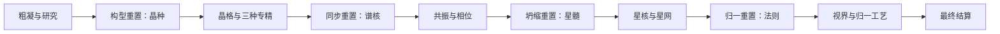

# 增量游戏内容设计：有限宇宙

[设计方案](设计方案.md) · [原有玩法约束](增量玩法与两层重置.md) · [首版数值](增量游戏首版数值.md) · [设计校验](增量游戏设计校验.md)

2026-11-01，内容提案 v0.2.1。本文把现有约束补成一套可以进入规则原型的具体玩法。名称、层数、科技、费用和挑战是本次提出的候选内容，不宣称已由用户定案、已实现或完成平衡。旧版网页演示不代表本设计。

## 1 玩家在做什么

终局主原料以约 `64,000×256,000,000` 为量级基准，压缩加工和支撑另计；本版按终局每 Q 形成 100 万点重新标定候选数值，详见[投入口径](投入与物质转换.md#21-主原料规模与独立成本)。

玩家把一批有限物质封闭在反应堆中，培养越来越精密的物质转换工艺。研究和重建会吃掉这批原料，提前生产也会减少后续投资能力。每次选择都在回答：用多少原料发展，留多少原料兑现，是否值得再重置一次。

题材使用微型宇宙中的晶格、振动、恒星与因果结构。它们是生产和研究系统，不加入居民养成、人员返还或跨外层运行的文明科技。

核心体验按三个尺度展开：

| 尺度 | 玩家决策 | 可观察结果 |
| --- | --- | --- |
| 数十秒至数分钟 | 原料分配、研究路线、工艺选择、完成本次试验 | 吞吐、剩余预算、已入账价值变化 |
| 十几分钟至数小时 | 下层重建、上层资产配置、挑战顺序、通讯采购 | 更高工艺、更便宜或更快的重建、不可逆的材料支出 |
| 连续多轮 | 备料、支撑、供电、快慢堆分工、结算策略 | 每轮收益及完整周期效率；自动化资格与策略保留 |

不要求持续点击获取基础资源。手动交互用于选择和确认；生产从启动后的正常供电获得。达到关键节点时暂停提示可配置，批量购买和预设用于减少重复操作。

## 2 八档工艺与四级重置

**工艺档位和重置层级分别建模。** 八档工艺提供纵向产额，四级重置引入不同的经营机制，避免把八层全部做成相同的声望按钮。

| 工艺 | 名称 | 核心解锁条件 | 单位原料基础点值 | 本段的新决策 |
| --- | --- | --- | ---: | --- |
| P0 | 粗凝 | 开轮；应急低速转换始终可用 | 0.1 | 研究和直接兑现如何分料 |
| P1 | 晶格 | 当前持有至少 1 个晶种 | 1 | 三种专精与晶种配置 |
| P2 | 共振 | 当前持有至少 1 个谱核 | 10 | 双频校准、首次自动化资格 |
| P3 | 相位 | 当前持有谱核，购买 P3 工艺站 | 100 | 先扩大本段产出，还是保存下一次重置预算 |
| P4 | 星核 | 当前持有至少 1 份星髓 | 1,000 | 三条局部产线的配比与瓶颈 |
| P5 | 星网 | 当前持有星髓，购买 P5 工艺站 | 10,000 | 自建、局部通讯和整段支援的成本比较 |
| P6 | 视界 | 当前持有至少 1 枚法则 | 100,000 | 为最后试验保留多少原料 |
| P7 | 归一 | 持有法则，建站并完成两项本地终局试验 | 1,000,000 | 停止投资、安排最终转换和唯一结算 |

表中条件还需支付对应建站和科技费用，详见数值表。拥有高层资产时，可以直接建立对应工艺站；下层重置不强制重新买与该高层无关的设备。工艺站属于相应层级，会被清理该层级的重置删除。

每个阶段都能提前结算。P3、P5 是可选的本段生产投资，不是前往下一层必买的过路费。高层工艺不追溯提高低层成果价格。

## 3 资源与物质账

| 状态 | 性质 | 来源与用途 |
| --- | --- | --- |
| 原料 Q | 精确物质余额 | 本轮投入；建设、升级、科研、试验、通讯、生产共用 |
| 活化料 A | 普通中间物质 | Q 经处理得到；供基础科研或工艺转换；内部重置可清除 |
| 结算物质 S | 内部永久物质账 | 从实际转换中形成，不能重新投回研究或生产 |
| 已形成价值 V | 与 S 对应的精确价值账 | 每次转换按当时工艺记价，只有外层结算可交付 |
| 研究量 X、科技点 TP | 非物质的信息状态 | 消耗 A 获得；TP 是累计生成量减累计支出 |
| 晶种、谱核、星髓、法则 | 非物质的核心资产 | 用付费研究和试验换取，改变本轮的能力；不能直接兑资源点 |
| 试验进度 W | 非物质的局部工作记录 | 每份有效工作都有耗材；兑换后清零，不能重复领奖 |

核心资产不是可再次还原成原料的实物。即使显示巨大数值，也不能与 Q、S 或外部资源点互换。

每轮持续对账：`初始原料 + 已收物质 = Q + A + S + 在用设施物质 + 各类损耗 + 已转出物质`。建设占用、科研消耗、科技费用、试验耗材、通讯费用、重置损耗分栏显示。设施被重置时将其物质转入损耗，不退回 Q。

正常工艺链为 `Q → A → S`，新 A 下一真实帧才可使用。试验台直接消费分配到的 Q，产生不可兑奖的信息进度，避免虚构另一份可消费材料。一个真实帧按显式优先级预留 Q：手动/脚本动作费用、最低余额、试验与研究、生产；同级采用玩家比例，余数按固定资源 ID 顺序分配。

始终存在不收费重建的应急粗凝功能，以 1 原料/基准秒直接将 Q 变为 S，点值 0.1；价值先精确累积，最终结算才取整。它是机器自带的兜底能力，不创建可拆出或退款的设施。普通 P0 工艺站更快。缺少建站原料时仍能慢速收尾。

## 4 第一段：专精与构型重置

基础研究采用 `T_total = floor(10 × log2(1 + X/100))`，`T_available = T_total - T_spent`；每单位 A 产生 45 研究量。基础研究量、已花点数和节点归属都在 R1 时清除。

三条路线均为 12 / 22 / 46 TP，物质基础价为 120 / 240 / 450，再分别乘本轮 K 并按费用规则取整。没有路线硬互斥。

| 路线 | 第一个节点 | 第二个节点 | 第三个节点与试验 | R1 获得 |
| --- | --- | --- | --- | --- |
| 通量 | 并行通道：本子轮 P0/P1 转换吞吐 ×1.25 | 流束分配：再 ×1.20 | 脉冲试验：完成 1,800 工作 | 通量晶种 1 |
| 有序 | 结构筛选：本子轮 P0/P1 点值 ×1.10 | 晶格约束：再 ×1.10 | 均匀试验：完成 1,800 工作 | 有序晶种 1 |
| 解析 | 研究队列：开放按 TP 阈值自动停止研究 | 条件分配：开放本子轮的研究/试验预算条件 | 对照试验：左右各完成 900 工作 | 解析晶种 1 |

解析路线的早期条件器只控制本子轮既有研究/试验分配，不购买科技、不重置、不结算；它不等于完整持久自动化模块。所有人都有手动停止、数值目标和批量购买，条件器不剥夺基本界面便利。

三项试验的总基准处理能力均为 30 工作/秒，消耗 0.1 Q/工作，总耗材 180。对照试验把总能力分配给两个计数器；均匀试验按累计工作划分 12 个等长检查点，不逐批循环执行。完成条件使用实际计数，不能用单纯运行时间替代。

R1 要求所选路线全部节点和对应试验完成，一次只兑换一个所选类型的晶种。兑换清除全部 B0 研究、未兑换试验、设施和 A；未选路线不会自动多发晶种。若在同子轮兼修，额外花费和未兑换进度仍会损失。

## 5 第二段：同步、谱核与早期通关

当前各持有至少一个通量、有序、解析晶种，才能建设同步试验台。完成正频、反频各 450,000 工作后可执行 R2。两项必须依序进行，总耗材 900,000 Q；每项基准能力 3,750 工作/秒。

R2 清除 B0、B1，包括晶种、下层工艺站和同步进度，增加 1 个谱核。三个晶种都被清除；多囤的晶种也被清除，不能默认只消耗配方所需的三个。

拥有谱核后，玩家可以建立 P2/P3 工艺站，也可继续从 R1 重建以积累下一枚谱核。谱核带来的通道资格保留在其作用范围内；普通科技、设备和原料不会因此免费恢复。

**首次核心通关**：本轮至少完成一次 R2，并实际形成不少于 1,000 点 P2 或更高工艺成果，再最终结算。结算时授予玩家持久自动化资格。它和 P7 终局是两个目标；第一轮推荐 2,000,000 Q、80% 升级材料利用率。

首次通关后，新轮可直接启用已有预设和脚本。允许玩家通关后继续深玩当前轮，但资格在该轮最终结算时确认；界面在达标时明确给出“现在结算以解锁后续自动化”。首轮不引导玩家手动一直重建到 P7。

## 6 第三段：三线调度与星髓

持有至少三个谱核后，建设引燃试验台。其三条工作线分别消耗 Q，目标为燃料线 120×10^9、约束线 80×10^9、反馈线 40×10^9；这些工作记录不能转成 S。

基准总能力为 `240×10^9 / 900` 工作/秒，玩家按比例分配。每条线的基准上限分别为总能力的 1/2、1/3、1/6；默认 3:2:1 可以同时在 900 基准秒完成。超过某条线上限的分配闲置，不能转成负费用或额外产量。实际材料按有效工作量扣除。

试验台可在运行中调整比例；已有工作不清除。错误分配主要延长时间，错误建站、反复重置或把 Q 用于其他用途才会耗掉预算。两类失败必须在提示中区分。

三线全部完成后执行 R3：清除 B0–B2，增加 1 份星髓。此时可以建 P4/P5，或继续重建谱核、积累下一份星髓。三个谱核和该层配置效果随 R3 删除。

## 7 第四段：因果闭合与终局选择

持有三份星髓后，建设因果试验台。先完成正向 1.5×10^12 工作，再完成逆向 1.5×10^12 工作；每工作消耗 1 Q，基准能力为 `3×10^12 / 1,800` 工作/秒。顺序由明确的阶段状态控制，不能提前囤积逆向进度。

完成后 R4 清除 B0–B3，增加 1 枚法则。法则使玩家可以直接建设 P6，或继续投入 P7。此时仍可以选择低一级生产，不要求把所有剩余原料押在终局。

P7 需支付工艺站与工艺科技费用，并完成两项本地试验：

| 试验 | 条件 | 有效工作与失败规则 |
| --- | --- | --- |
| 静默试验 | 本机停止所有新通讯；不影响别堆 | 消耗 10^11 Q，基准 1,800 秒的工作量；启用通讯前提示并取消本项未完成进度，已花材料不返还 |
| 对偶试验 | 两个工作通道各完成 0.5×10^11 | 总能力 `10^11/1,800` 每秒，单通道最多占总能力 1/2；错误分配只会减速，不免费补齐 |

两项可以任选顺序，参考路线顺序完成；只同时运行一个终局试验。进度和完成标记属于 B4；下层重置不会清掉已经完成的高层试验，再次 R4 不给相同法则额外免费终局成果。P7 解锁没有一次性资源点奖励，只有实际最终转换形成价值。

这里的“1,800 秒”是工作量除以基准工作能力，不是现实倒计时。合法 FE 加速提高同帧工作量，并支付相应原料；没有强制等待到点才能过关的冷却。

## 8 上层资产怎样帮助重建

每个核心资产可以保持未分配，或放入一个功能槽。分配不消耗资产，不改变下一层所需数量；上层重置会删除作为前置的全部下层资产及其效果。**同一枚资产一经分配，在被上层重置清除前不能换槽**；未分配资产可在后续帧选择一次。这样，优先加速当前研究还是后续试验是实际取舍，不会通过每个阶段免费换槽同时获得全部效果。配置在下一帧生效。

| 资产与配置 | 影响范围 | 每个投入的效果，上限 |
| --- | --- | --- |
| 通量晶种→重建 | B0 基础活化与研究能力 | +25%，最多按 3 个计；不降低科研材料成本 |
| 有序晶种→生产 | 仅 P0/P1 吞吐 | +25%，最多按 3 个计；不修改已产价值 |
| 解析晶种→试验 | 仅 R1 有效工作能力 | +25%，最多按 3 个计；每工作耗材不变 |
| 谱核→底层研究 | 仅 B0 活化/研究能力 | 每个 ×2，最多 3 个；与晶种能力相乘 |
| 谱核→同步 | 仅 R2 试验能力 | 每个 +50%，最多 3 个 |
| 星髓→同步 | 仅 R2 试验能力 | 每份 ×2，最多 3 份 |
| 星髓→引燃 | 仅 R3 三线能力与各线上限 | 每份 +50%，最多 3 份 |
| 法则→重建 | 仅 B0–B3 的试验/研究能力 | 每枚 ×2，最多 2 枚；不改变 P6/P7 产额和终局试验 |

每个谱核或星髓只能占一个槽，允许空置；同种配置的效果按当前投入数量计算，到上限后的多余投入应被拒绝。它们只改变吞吐，不自动保留科技，不更改 K，不免费生成工作。参考数值路线将所有资产留空，先给出不依赖这些优化的可行预算；后续必须比较配置策略，不能将该参考路线称为近优。

## 9 重置保留矩阵

状态分区固定为：B0 基础研究/试验/普通活化料；B1 晶种、P1 与同步试验；B2 谱核、P2/P3 与引燃试验；B3 星髓、P4/P5 与因果试验；B4 法则、P6/P7 与终局试验。P0 普通站在 B0。各区的设施、科技、普通货币和试验均随该区一起清除。

| 操作 | 清除的成长分区 | 本次新增 | 其余保留 |
| --- | --- | --- | --- |
| R1 构型 | B0 | B1 中所选晶种 1 | B1–B4 中原有资产/站/状态；Q、S、V |
| R2 同步 | B0–B1 | B2 中谱核 1 | B2–B4；Q、S、V |
| R3 坍缩 | B0–B2 | B3 中星髓 1 | B3–B4；Q、S、V |
| R4 归一 | B0–B3 | B4 中法则 1 | B4；Q、S、V |
| 外层最终结算 | B0–B4、本轮 Q/A/S/V、投入及接口 | 唯一结算收据 | 外部自动化资格、策略、已交付点数、其他堆 |

所有内部重置都清除共享普通 A，并记为损耗；不能把普通物质藏在高层站中免除清理。高层工艺站保留，但其原料缓冲不保留。Q、S、V 与锁定投入始终不变，除非本次操作另有明确、预览可见的费用；重置兑换本身不另收重建费，不自动重建。

重置仅在本机对应研究/试验达标时可点，允许暂停时手动重置但不产生额外工作。上层资产以本机完成后的进度兑换；接口不能发晶种、谱核、星髓、法则或完成标记。批量兑换 R1–R4 不开放，避免隐藏跨多个重新付费周期的过程。

## 10 两个通讯区段

首版只开放付费工作支援，**不开放原料和普通中间物质导入**，因此不会通过导入 Q 绕过开局承载。通讯请求必须包含双方 runId、接口、工作种类、数量上限、费率版本和收发序号。

| 接口 | 本机首次解锁 | 保留范围 | 可请求的帮助 |
| --- | --- | --- | --- |
| C1 晶格链路 | 本机完成 R2 且当前持有谱核，支付 5,000×K Q 解锁 | R1/R2 保留；R3 清除 | 基础研究量；R1 试验的部分有效工作 |
| C2 相位链路 | 本机完成 R3 且当前持有星髓，支付 5,000,000×K Q 解锁 | R1/R2/R3 保留；R4 清除 | 包含 C1 目录，并可支援 R2 双频工作 |

双方都必须具有相应能力、正在运行且供电。C2 已解锁时可替代 C1 资格，不恢复任何库存。R3/R4 后重新买接口需重新支付；外层新轮没有接口。接口开启成本是科技费用乘 K，持续通讯费不乘 K。

采用“当前有效工作委托”：来源直接消耗自己的 Q，接收方消耗通讯费，合并写入接收方当前研究/试验进度。按当前作用域分别记录本地与援助工作，并始终限制 `援助工作 <= 4 × 本地工作`，因此至少 20% 来自本机。基础研究对 X 使用同一约束，不依赖玩家自报的目标量；不能通过临时调高目标绕过本地要求。允许的试验进度另受固定目标量限制。所有帮助仅适用于当前已解锁的有效目标，不能预存未解锁阶段进度或完成上层试验。

收费单位定义为**等效研究/试验原料量 H**：基础研究每 45 X 等于 1 H；R1 每 10 工作等于 1 H；R2 每 1 工作等于 1 H。来源支付 H，接收方支付 C1 的 H/4、C2 的 H/2。固定点累计收费，不按消息数取整。来源每基准秒可输出 C1 的 10 H 或 C2 的 5,000 H；同一来源的所有目标共享此限额，接口不叠加目录能力。按双方实际有效速度较小者限制交付，再受余额和目标剩余量约束。

工作到下一帧才可判定研究/试验完成。来源材料支出记为协同损耗，接收方通讯费记为通讯损耗；没有物质凭空入库。接收方下一次重置删除该工作不会退款。请求在任何一方重置后绑定旧目标的部分取消；已经交付的合法工作归接收方，不因来源结算回滚。

该定价使机群总材料比自建多付 25%/50%，帮助的价值应来自时间、并行安排或来源重建能力。双方数量耗电惩罚照算，单堆无需通讯即可完整通关。多机净优势必须实测，不能把辅助功能的存在写成最优策略。

## 11 自动化、交互与失败反馈

预设与玩家 JS 共用合法动作：启动、设置原料保留量/比例、买站、买科技、设置核心配置、选择目标、请求/停止帮助、R1–R4、暂停/恢复、最终结算。每帧最多 16 个意图，顺序执行；单个非法意图拒绝并记录原因，其后仍校验，终结本轮后其余旧 runId 动作全部拒绝。本批费用按暂存状态顺序预留。

预设提供：首次核心通关、指定工艺生产、深层突破、保留预算、缺料收尾、连续多轮。默认不开启“缺料即结算”；启用时应显示策略可能放弃的局部进度。自动重开网页实验轮意味着新的模拟外部投入，不能声称已经实现外部库存扣料。

界面按准备、成长树、工艺、通讯、账本与策略组织。成长树显示当前核心及其保留范围；每个重置按钮打开清除/保留预览。工艺卡同时显示每秒原料吞吐、每原料点值、每秒点数和升级实际成本。账本显示已形成价值和原料分别保留，不能只显示一个合并的“总资产”。

物质不足提示至少区分：本动作差多少、达到当前目标尚需多少确定费用、规划器是否有可行替代路线。静态下界不足只能说“该参考路线不可支付”，除非已检查全部合法路线，不能断言“本轮绝对无法通关”。等待可以解决工作进度，不能补齐 Q；系统应给出低层收尾和提前结算入口。

## 12 实现范围与进入下一步的条件

这套提案先以物质量和升级材料利用率直输入，形成可执行的内部游戏。Minecraft 载体、支撑配方、Sigmoid 最终曲线、特殊模块价格、世界库存和 FE 交接沿用原文的待定边界；不臆造它们已经完成。首个内部基线不装特殊模块。

足够开始无界面规则原型的内容包括八档工艺、四级兑换、清除矩阵、明确预算、早期通关和两档收费工作支援。完成原型还必须通过：精确账本、重复动作/帧去重、各层可达性、真实操作序列、预设连续运行、跨堆原子扣费及存档恢复。通过后再接 TMT 界面和 Minecraft 世界桥。

本稿的主要设计风险是：27 次 R1 的重建是否足够有趣、解析路线是否只是被动过路费、低层在高预算下是否快速失去价值、通讯时间收益能否覆盖双机能耗、核心配置是否出现唯一支配方案。这些应由可玩原型检验；增加更多层数和节点不能替代这些检查。
