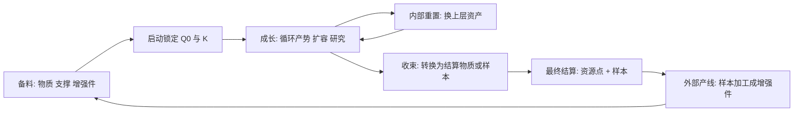

# 增量游戏（资源反应堆）整体玩法方案

2026-11-19 · 整体玩法提案 v0.3 草案。只定玩法骨架，不定最终数值和实现；文中出现的数量级都是占位，等原型跑过再定。

依据：`docs` 分支「闪电科技资源」全部 13 篇（提交 `ea9fcc1`），以及你这次给的五条方向：

1. 混合型：预算约束 + 轮内真增长。
2. 轮内上限和最终产出受预算约束，最终产出和预算基本成正比。
3. 不要永久成长；可以有一次性增强，由玩家建立“增强产线”持续供给。
4. 轮长分档：短轮十几分钟到 1 小时，终局轮数小时，投入规模决定轮长。
5. 先做玩法原型和玩家脚本，用 Node 跑起来，暂不考虑接入 Minecraft。

---

## 1 结论

- **保留**现方案的外壳：独立附属、反应堆 + 转化器、三类投入、载体与支撑、开局锁定的升级物耗倍率 K、封闭周目、只在最终结算发点、精确账本、固定真实 tick、JS 脚本。
- **重做**轮内内核。现内核和你的第 1、2 条直接冲突（见第 2 节），不是调数值能解决的。
- 新内核一句话：**物质是本金，不是燃料。** 物质在反应堆里“做功”产生一种不是物质的轮内资源（暂名“势”），势用来滚雪球；物质本身只会被结构占用、被损耗、或被转换成结算物质。最终点数 = 结算掉的物质 × 品位。品位沿一条渐近曲线逼近上限 `C` 但永远到不了，所以点数永远小于“预算 × 固定单价 × C”。
- 跨轮成长全部外置：反应堆除了资源点还能结算出**样本**。样本有三个用途：做一次性增强件、升级转化器对稀有资源的转化速率、高科技配方的门槛。资源点买“量”，样本买“质”。
- 自动化不再是通关奖励，而是一件用首批样本制作的外部设备“自动化核心”；内置脚本随样本层级逐步解锁，玩家自己写的脚本不受限。

---

## 2 为什么要重做内核

| 你的要求 | 现方案的实际情况 | 依据 |
| --- | --- | --- |
| 最终产出和预算基本成正比 | 预算扩大约 820 万倍，产出扩大约 1 万亿倍，单位物质产额相差约 12 万倍 | 教学轮 2,000,000 Q 最多 9,038,200 点（约 4.5 点/Q）；终局 16,384,000,000,000 Q 到 long 上限（约 562,950 点/Q） |
| 短轮长期有用 | 发展费用是固定的绝对数量，终局路线要 6.2×10^12 Q；低于这个量根本进不了高档工艺，小预算轮只能拿零头 | 首版数值第 3、6 节 |
| 轮内真增长 | 轮内没有任何会自己变多的东西。研究、试验、建站全部直接烧原料，上层资产只加速不省料 | 内容设计第 3、8 节 |
| 每次重置后的打法不同 | 27 次 R1 每次都是同样的 2,060 Q、同样的约 155 秒；参考路线把全部资产槽留空 | 首版数值第 6 节 |

结果是：现方案在满配时，最优路线基本是一张固定时间表（文档自己也把“27 次 R1 是否有趣”“是否出现唯一支配方案”列为主要风险）。逐档 ×10 的单位产额是根源，它必须换掉。

---

## 3 新内核

### 3.1 两类量

| 类别 | 是什么 | 增长方式 | 上限 |
| --- | --- | --- | --- |
| **物质 Q** | 本轮投入的本金，精确守恒 | 不增长，只减少 | 开局投入量 Q0 |
| **势** | 物质在循环器里做功产生的轮内资源，不是物质 | 指数增长，可以是天文数字 | 产出速率受“正在循环的物质量”限制 |

势买的是产能、研究和重置资格；势本身不能结算成点数。这样“大数字滚雪球”和“产出有界”互不干扰。

### 3.2 物质的五个去处

每一份物质在任一时刻只处于一种状态，全程对账：

```text
Q0 = 自由物质 + 结构占用 + 已结算物质 + 样本胚 + 损耗
```

| 状态 | 说明 |
| --- | --- |
| 自由物质 | 放进循环器就产生势；不会因为做功而减少 |
| 结构占用 | 建循环器、转换站等要嵌入物质；嵌入量 × K 实付，多付的部分直接记损耗 |
| 已结算物质 | 经转换站不可逆转换，按转换那一刻的品位记价 |
| 样本胚 | 不可逆转成的通用保留资源，结算时转化成某一级样本带出（见第 6 节） |
| 损耗 | K 的额外支出；内部重置时被清掉的结构所占用的物质 |

现方案的“两本永久账”（未用原料、已结算物质任何内部重置都保留）原样成立。

### 3.3 产出为什么和预算成正比

```text
品位 g(x) = C × x / (x + h)          x ≥ 0 是精炼度，h 是半程常数（x = h 时品位为 C/2）
本轮点数 = P × Σ(每批转换的物质量 × 该批转换时的品位)
回收率 = 本轮点数 / (P × Q0)
```

- `C` 是**回收率上限**，规则表里的一个明确常数。它不是结算时的截断，而是品位曲线的渐近线：精炼度再高，品位也只会无限接近 `C`，永远到不了。
- 每一批的品位都小于 `C`，转换的物质总量又不超过 Q0，所以**无论怎么操作、装什么增强件，本轮点数都严格小于 `P × Q0 × C`**。这是公式本身保证的，不需要任何截断。
- 一切提高品位的手段——轮内精炼、上层资产、增强件——都只能加到精炼度 `x` 上，再过同一条曲线；不允许任何东西直接乘在品位或点数上。叠得越多，每一份的收益越小。
- 曲线形状我建议用上面这种反比例型，因为它只涉及整数的乘除，精确账本里可以不丢精度地算。对数更适合用在里面一层，即“投入多少势换多少精炼度”（现方案的科技点公式本来就是 `log2`）。两层叠起来就是：势 → 对数 → 精炼度 → 反比例 → 品位。具体取哪种、常数多少归数值设计。
- `P` 是全局固定单价，按“可启动的最大投料量”标定（见 7.1），使理论上界 `P × 最大投料量 × C` 不超过 long 最大值。占位：最大投料量取现方案的终局基准时，`P × C` ≈ 562,949 点/Q。
- 所有会吃掉物质的东西都是**比例型**的：建多大产能就占用多少物质，产能需求又和预算成正比。所以同样水平的操作，在任何预算规模下回收率应当接近。这是原型要验证的头号假设，不是已证明的结论。
- 玩得好坏体现在回收率（比如新手是 `C` 的四五成、熟练是 `C` 的八成左右，占位）和轮长上，而不是数量级差异。

### 3.4 工艺档位改成“规模档位”

保留 P0–P7 八档和名字（粗凝、晶格、共振、相位、星核、星网、视界、归一），含义改为：

- **每升一档，吞吐约 ×10**，对应能在合理时间内处理的预算规模大一个数量级。八档正好覆盖 10^6 到 10^13 这七个数量级。
- **每档的精炼度各自从零起步，品位沿 3.3 的曲线向 `C` 逼近**。精炼费用按转换站规模计价，所以大预算不会因为势多就白拿高品位。
- 由此产生每个规模都存在的选择：留在已精炼好的低档（品位高但慢），还是升到新档（快但品位要重新精炼）。

### 3.5 时间从哪来

没有倒计时。轮长由“把产能养到配得上这笔预算”需要多久决定：

- 循环容量从很小开始，势买容量，容量产势，指数增长，直到容量追上自由物质量——**这就是预算对轮内增长的硬上限**。
- 之后的增长只能来自效率：研究、重置换来的上层资产、增强件。
- 预算越大，需要的档位越高、重置层数越深，每深一层节奏更慢，所以轮长随预算的对数增长，再叠加层级放大。
- 供电不加速。电是轮内生产的投入，给够就满速，多给无效（见 7.3）。想更快只能靠增强件。

### 3.6 一轮的流程



成长和收束可以重叠：提前开始转换能缩短轮长，但那部分物质按当时较低的品位记价，并且不再产势。

兜底规则沿用现方案：机器自带一个不需要建造的低速、低品位转换，任何时候都能用它把剩余物质慢慢转掉；任何时候都可以提前结算。一轮不会进入“什么都做不了”的死局。

---

## 4 层级与重置

四级重置和资产名字沿用现方案，改三件事：

1. **重置所得由本子轮攒到的势决定，递减回报。** 多攒一会儿再重置，还是早重置多滚几次，是每一层都要做的判断。不再是固定的 27/9/3/1 配方树。
2. **重置的物质代价是比例型的：** 被清掉的结构所占用的物质记为损耗。重置越频繁、每次建得越大，损耗越多。
3. **上层资产让下一次重建明显更快、更省。** 第二次重建应比第一次快数倍，而不是每次一样长。

| 层 | 主题 | 这一层新增的决策（候选） | 重置所得 | 预算档 |
| --- | --- | --- | --- | --- |
| 0 凝聚 | 三种循环器逐个购买（逐个涨价、每 10 个容量翻倍）、一次性升级、转换站、三条研究专精（通量 / 有序 / 解析） | 下一步买哪种循环器、哪个升级；专精哪条 | R1 构型 → 晶种，类型取决于专精 | 所有轮 |
| 1 共振 | 晶种槽位组合；双频校准 | 晶种怎么配；两个频率的投入配比 | R2 同步 → 谱核 | 短轮可达 |
| 2 星核 | 三线产线（燃料 / 约束 / 反馈） | 三线配比与瓶颈 | R3 坍缩 → 星髓 | 中轮 |
| 3 视界 | 因果闭合与终局收束规划 | 留多少物质做最后一段成长，何时全面收束 | R4 归一 → 法则 | 终局轮 |

- 三条专精保留对数科技点 `floor(A × log2(1 + X/X0))`，研究量 X 改由势换取，不再直接烧原料。
- 资产放入功能槽、一经分配不能换槽，这条保留。资产效果的候选方向：提高循环效率、降低结构的物质占用比例、抬高新档品位起点、解锁更高档位。
- 第 2、3 层的具体机制只是方向，等第 0、1 层在原型里证明好玩之后再细化，不提前铺内容。

---

## 5 玩家到底在决定什么

| 时间尺度 | 决策 | 代价的形式 |
| --- | --- | --- |
| 秒到分钟 | 势花在扩容、研究还是精炼；自由物质留多少继续循环 | 时间 |
| 几分钟到几十分钟 | 何时重置；资产放哪个槽；升档还是精炼当前档 | 时间 + 物质损耗 |
| 一轮之内 | 何时开始收束；多少物质转样本胚、多少转点数；结算哪一级样本 | 回收率 vs 轮长 vs 下一轮的增强 |
| 多轮之间 | 投多大预算、多少支撑、装哪些增强件；短轮和长轮怎么排 | 外部产线的产能 |

**为什么不会退化成一张固定时间表：** 最优策略取决于 Q0、K、增强件组合、供电是否充足，以及玩家自己的目标——支撑充裕时应该跑快轮、接受较低回收率；支撑紧张时应该慢慢榨干。这几个输入每个存档、每个阶段都不同。

---

## 6 跨轮成长：样本

这部分对应你的第 3 条，也把现方案里一直“待定”的特殊模块变成主系统。

### 6.1 样本是什么

轮内可以把一部分物质不可逆地转成一种通用的保留资源（暂名“样本胚”），最终结算时把它转化成某一级的样本，作为实物交付到外部存储。

- **每一级有每一级的样本**，共四种，对应四级重置：晶格样本、谱核样本、星髓样本、法则样本。
- **样本胚不分级别。** 它和原料、结算物质一样，任何内部重置都不清除。
- **最终结算时只能结算一级**，一轮只带出一种样本。采用“最后选”：结算时再选把样本胚转化成哪一级的样本，只能选本轮打到过的级别。
- **每级的转化率各自设定**（多少样本胚换一份该级样本），归数值设计。样本级别之间不互相折算。
- 以后如果想要“这一轮专门刷某一级”的路线感，可以加一种开局锁定级别、换更高转化率的增强件，现在不做。
- 样本和点数争用同一笔预算，总量受预算约束。
- 样本本身没有效果，带出后只作为外部配方的原料。

**样本分级就是增强件随规模缩放的方式。** 支撑再次进入某一级的轮，要用同级样本做的增强件，或者把上一级样本做的增强件装满：

- 常规循环：这一轮结算同级样本，做成增强件，支撑下一轮打到同样的深度。
- 往上开荒：没有更高一级的样本，只能把本级的增强件装满去够，代价高。
- 一轮只能带出一种样本，所以想要哪一级的样本，就得专门跑一轮并在那一级结算。各级的轮各有各的产出，深层轮不能顺手把浅层样本也带出来。

### 6.2 三个用途

| 用途 | 怎么用 | 消耗方式 |
| --- | --- | --- |
| 增强物件 | 样本 + 常规材料 → 一次性增强件，下一轮开局装入 | 每轮消耗 |
| 稀有资源门槛 | 样本制作转化器的**速率升级件**，决定稀有产物的转化速率 | 制作时消耗，装上后保留 |
| 高科技门槛 | 高阶机器、高阶组件（包括分级支撑、自动化核心和策略卡，见第 7.1、8 节）的配方需要样本 | 每次合成消耗 |

稀有资源门槛的规则：

- 稀有来源在没有速率升级时不开放。装入第一级升级件后以很低的速率开放，之后每一级提高速率，最高级有明确的速率上限。
- 级别越高，需要的样本层越深、数量越多。
- 升级件按转化器、按来源类别分别安装，多建一台转化器就要再做一套。
- 兑换价格（资源点）不随升级变化，升级只改变单位时间能换多少。

这样做的两个结果：

- 稀有资源有了明确的单位时间产量上限，这是现方案里一直没定的“是否需要严格产率上限”。
- 价格不受样本影响，定价规则保持简单。

持续消耗样本的是增强件和高科技配方；速率升级是一次性的设备投资，靠“级别递增、按台按类别安装”保持长期需求。

约束：首轮不能依赖样本。第一台反应堆、第一轮备料、基础转化器和普通来源都必须用普通材料做得出来。

高科技门槛分内外两种：

- **外部是硬门槛**：高阶机器、高阶组件的配方必须消耗样本，没有就做不出来。
- **内部是软门槛**：不设专门的“钥匙”物品。深层的进入条件（首次重置所需的势）对不装增强件的裸装轮来说本来就定得很高，靠**各种外部增强件的组合**才够得着。
  - 势是指数增长的，差得不多只是多花时间；但循环容量被预算封顶，差得太多时根本攒不到。所以裸装的结果是“上不去，或者要用远超正常的预算和很好的操作才上得去”。
  - 第 1 层裸装可达，保证首轮能打。
  - 不刻意规定哪一件是某一层的必需品。每类增强件从不同方向帮忙（见 6.3），同一层最好有两三套不同的组合都能打到；如果某一件事实上成了必装，留给后续路线设计和数值微调处理。
  - 增强件槽位有限，“冲层的配装”和“榨回收率的配装”用的不是同一批件，装什么本身就是决策。
  - 开荒新一层时没有同级样本，要靠把上一级样本做的增强件装满去够；打到之后在该级结算拿到同级样本，再次进入就走常规循环（见 6.1）。

这样形成短轮 → 中轮 → 终局轮的阶梯：每一级的常规循环靠同级样本自给，往上开荒靠把本级增强件装满。因为一轮只带出一种样本，浅层轮在后期仍然是浅层样本的来源。

### 6.3 增强件

用 LT 现有机器（闪电装配室、过载处理工厂等）加工，配方由整合包决定，天然适合用 ME 样板自动化。开局装入，本轮生效，结算清除，不返还。

| 增强件类别 | 候选例子 | 它改变的决策 | 对冲层的帮助 |
| --- | --- | --- | --- |
| 起步件 | 开局自带若干晶种或预建循环器 | 短轮更短，适合刷量 | 省掉前期重建，把时间留给深层 |
| 效率件 | 提高循环效率，或降低结构的物质占用比例 | 同样预算能养多大产能 | 同样预算攒到更多势 |
| 路线件 | 开放第四条专精，或某层的替代机制 | 本轮走哪条路线 | 提供更适合冲层的路线 |
| 精炼件 | 某档开局自带一份精炼度，或重置损耗降低 | 值不值得多重置一次 | 基本没有，主要提高回收率 |
| 变异件 | 带代价的规则改写，如“品位起点更低，但势产出更高” | 整轮打法 | 用回收率换深度 |

设计要点：

- 高级增强件、高级速率升级和高科技需要高级样本，高级样本要打到对应的层、经过多级转化才有。
- 增强件每轮消耗，需求是持续的——玩家的长期目标就是把增强产线建大、建全，这正是“外部产线变强”而不是“面板数字永久变大”。
- 这推翻了现方案的一条规则：“轮末只能带出资源点”改为“只能带出资源点和样本”。

---

## 7 外部投入（基本不变）

- 三档载体的物质量与支撑需求、有限分级支撑、下降型 Sigmoid、`η = 1/K` 且不低于 10%：全部保留。
- K 的作用点从“科技升级物耗”自然落到“结构占用物质的实付倍率”。K = 1.25 意味着每次建造多损耗 25% 的嵌入物质，直接体现为回收率下降几个到十几个百分点。
- 暂停不计入同时运行数量，这条保留。供电规则改动见 7.3。

### 7.1 分级支撑就是单轮投入的上限

不另设“单轮投入上限”这条规则，由分级支撑承担：

- **支撑分级，高一级的支撑要用同级的样本制作。** 基础支撑用普通材料，保证首轮能打；一级支撑要晶格样本，二级支撑要谱核样本，以此类推。
- 每一级支撑能承载的物质量比上一级高出一截（候选：每级约两个数量级）。拿不到某一级的样本，就做不出那一级的支撑，也就装不下那个量级的物质。**投料量主要靠这一条压住。**
- 支撑是本轮投入，结算后不返还，所以每一轮都要消耗同级样本做的支撑，和增强件是同一个循环。
- 同一级支撑之内：物质装得越多，支撑比越低，K 越大，建造损耗越重，回收率越低，多装的收益递减。
- 升级材料利用率 `η = 1/K` 低于启动阈值（比如 5%，取值归数值设计；现方案写的是 10%）时直接禁止启动。
- 于是可启动的最大投料量 = 最高级支撑在启动阈值下能承载的物质量，是一个确定的数。`P` 按这个数标定，使理论上界不超过 long 最大值，数据类型的边界就永远碰不到。

| 支撑 | 制作需要 | 候选承载量级 | 用来打什么轮 |
| --- | --- | --- | --- |
| 基础支撑 | 普通材料 | 10^6 – 10^7 Q | 首轮、R1 轮，产出晶格样本 |
| 一级支撑 | 晶格样本 | 10^8 – 10^9 Q | R2 轮，产出谱核样本 |
| 二级支撑 | 谱核样本 | 10^10 – 10^11 Q | R3 轮，产出星髓样本 |
| 三级支撑 | 星髓样本 | 10^12 – 10^13 Q | R4 轮，产出法则样本 |
| 四级支撑 | 法则样本 | 满配终局 | 终局的稳定循环 |

对数值设计的一个要求：K 的曲线必须在有限的超载程度下跌破启动阈值，否则同一级支撑能装的量没有上限。

原型阶段 A 的实测是：K 从 2 升到 20，回收率只降一半左右，单靠 K 压不住投料量（见 [数值文档 5.1](增量游戏数值与路线-第0-1层.md)）。所以不再要求“最优投料点落在禁止线以内”，同一级内最优点贴近禁止线是可以接受的，真正的上限由支撑级别决定。

### 7.2 物质免费，支撑才是成本

物质球和奇点的原料在 Minecraft 里基本可以无限产出，所以把物质当作不要钱的投入：

- 不为“资源点 → 物品 → 物质 → 资源点”的回灌设任何专门限制。回灌换来的物质，并不比刷石机之类的来源更有价值。
- 一轮的真实成本是**支撑**（以及增强件、FE、时间）。经济上要检查的是：一轮的产出明显高于这一轮消耗掉的支撑的成本，即只算支撑是净赚的。
- 玩家的长期成长因此落在两条外部产线上：支撑产线决定一轮能装多大，增强产线决定能打多深。

### 7.3 供电：供轮内生产用，不加速

现方案的 `sqrt(P/(B×2^(N-1)))` 平方根加速取消。原因：整合包后期的电力可以高出很多个数量级，平方根只是推迟问题；一旦电能无上限地压缩轮长，轮长分档、节奏上的取舍和单位时间产出的上限都会失效。

改为：

- **电是轮内生产的投入。** 循环器、转换站等结构工作时耗电，建得越多、档位越高，耗电越大。耗电随一轮的成长逐步上升，峰值和本轮规模相当。
- **需求由已建结构决定，给够就满速，多给无效。** 没有任何办法靠多供电换来超过满速的产出。
- **供电不足时按优先级分配**，不退化、不丢进度。每个结构有一个优先级，电从高优先级往低优先级依次供给；同一优先级内电不够分时，这一级的结构按比例降速，更低的优先级停工。
- 优先级对手动和脚本都开放。默认所有结构同一优先级，效果就是全部按同一个满足率降速。它只在缺电时有用，不产生超过满速的产出。
- **多台同时运行**仍按 `2^(N-1)` 放大每台的耗电需求。

电力的角色因此从“买速度”变成“买规模和台数”：电够不够，决定能开多大的轮、同时开几台。

玩法原型里电力只是一个“满足率”参数，默认取 1，不需要另外建模。

---

## 8 自动化与玩家脚本（原型优先项）

| 层次 | 面向 | 形式 | 何时可用 |
| --- | --- | --- | --- |
| 界面便利 | 所有人 | 批量购买、目标值自动停、条件提醒 | 始终 |
| 内置脚本 | 不写代码的玩家 | 暴露几个可调参数；已解锁的可以查看源码、复制修改 | 逐级解锁，见 8.1 |
| 玩家 JS | 想优化的玩家 | 每真实 tick 最多回调一次，读只读快照，返回有上限的意图列表和显式 memory | 装上自动化核心后不受限 |

### 8.1 自动化核心与内置脚本的解锁

现方案是“首次核心通关后永久获得自动化资格”。改为实物：

- **自动化核心**：一件外部设备，装在反应堆上，结算后保留。配方用第一种样本（晶格样本），因此玩家必须先手动打完一个短轮、至少完成一次 R1 才做得出来——这一轮就是教学轮。配方也可以由整合包改成直接用过载核心。
- 装上核心后，**玩家自己写的脚本立刻全部可用**，不设任何层级限制。
- **内置脚本逐级解锁**，不一次给全。每一级需要一张用对应层样本制作的策略卡，插入自动化核心后保留。因为那一层的样本只有打到那一层才产得出，所以每一级内置脚本都要求玩家至少亲手（或用自己的脚本）打通过一次。

| 内置脚本（候选） | 能做什么 | 策略卡所需样本 |
| --- | --- | --- |
| 基础托管 | 按目标自动扩容、买研究；不重置、不结算 | 核心自带 |
| 构型循环 | 自动判断并执行 R1 | 晶格样本 |
| 同步循环 | 自动执行到 R2；自动收束与结算 | 谱核样本 |
| 坍缩循环 | 自动执行到 R3；连续多轮自动备料重开 | 星髓样本 |
| 整轮托管 | 终局轮全流程 | 法则样本 |

未解锁的内置脚本不显示源码。会写脚本的玩家可以跳过这条阶梯，这是给写脚本的奖励；别人分享的脚本同样不管。

自动化核心和策略卡只省操作，不加产出、不降成本。

### 8.2 脚本接口

在现方案脚本设计之上补四点：

1. **快照里带报价。** 每个可执行动作的实际价格、重置的预计所得、当前回收率预估，都由核心算好放进快照。脚本不必自己抄公式，门槛低很多，也不会因为公式改版而失效。
2. **两级回调。** `onTick` 管轮内操作；`planRun` 管轮间：投多少、装什么增强件、是否自动重开。
3. **每轮出一份策略报告。** 回收率、轮长、点/小时、样本产量、物质去向分栏。脚本优化因此有明确的分数可追。
4. **沙盘试跑。** 同一个核心无界面全速跑，给定预算、K、增强件和脚本，直接出报告，用于对比策略。原型阶段在 Node 里天然具备；进 Minecraft 后是否开放、怎么限额以后再定。

脚本没有任何生产特权，手动、预设、脚本走同一套动作校验，这条不变。

---

## 9 规模分档（占位，待原型校准）

| 档 | 预算量级 | 预期到达 | 目标轮长 | 定位 |
| --- | --- | --- | --- | --- |
| 短轮 | 10^6 – 10^8 Q | R1、R2 | 10 分钟 – 1 小时 | 首轮教学、拿到做自动化核心的样本、刷浅层样本 |
| 中轮 | 10^9 – 10^11 Q | R3 | 1 – 3 小时 | 中期主力 |
| 终局轮 | 10^12 – 10^13 Q | R4 与最终收束 | 6 – 12 小时 | 接近 long 上限、深层样本 |

轮长指供电充足、基准 20 TPS 下的现实时间；供电不加速，所以这就是最短轮长，增强件可以再缩短。首轮教学仍控制在 15 分钟左右。

第一轮是手动短轮：完成至少一次 R1，转出一批晶格样本并结算，用它做出自动化核心。

---

## 10 延后的内容

- **多堆协同与收费通讯**：等单堆好玩之后再加。原则不变：一切帮助都消耗接收方和来源方的真实物质。在新内核下“势”是否可以跨堆转移需要单独设计，现在不定。
- **资源转化器的六类来源**：玩法原型阶段不涉及。

纯回灌不需要专门处理，理由见 7.2。

---

## 11 对照表

| 项目 | 现方案 | 本方案 | 理由 |
| --- | --- | --- | --- |
| 单位物质产额 | 八档逐档 ×10，0.1 到 1,000,000 点/Q | 固定单价 × 品位，品位渐近于 `C` | 你的第 2 条 |
| 工艺档位的作用 | 提高产额 | 提高吞吐，对应预算规模 | 同上 |
| 研究、试验的费用 | 直接烧原料，绝对数量 | 花“势”；物质只被占用和损耗 | 你的第 1 条 |
| 重置配方 | 固定 3:1，共 27/9/3/1 次 | 所得由攒到的势决定，次数自由 | 让重置时机成为决策 |
| 重置的物质代价 | 每次固定费用 | 被清结构占用物质的比例损耗 | 保持正比 |
| 特殊模块 | 待定 | 样本 → 增强产线 → 一次性增强件 | 你的第 3 条 |
| 轮末带出 | 只有资源点 | 资源点 + 样本 | 同上 |
| 样本的用途 | 无此物 | 增强件、稀有资源转化速率升级、高科技门槛 | 你的补充 |
| 单轮产出上限 | long 上限 | 严格小于 `P × Q0 × C`；由品位的渐近曲线保证，不靠截断 | 你的要求 |
| 自动化资格 | 首次核心通关后永久获得 | 用晶格样本（或过载核心）制作自动化核心 | 你的决定 |
| 内置脚本 | 通关后全部可用 | 按样本层级用策略卡逐级解锁；玩家脚本不受限 | 你的决定 |
| 目标轮长 | 满配 3–24 小时 | 按预算分档：短轮 10 分钟–1 小时，中轮 1–3 小时，终局轮 6–12 小时 | 你的第 4 条 |
| 多堆通讯 | 首版内容 | 延后 | 先验证单堆 |
| 供电 | 多供电按平方根加速 | 电是轮内生产的投入，给够满速、多给无效、不足降速 | 防止电力抹平轮长 |
| 载体、支撑、K、账本、固定 tick、脚本隔离 | — | 不变 | 没有冲突 |

---

## 12 原型验证计划（Node，无界面优先）

核心是一个不依赖浏览器的纯 JS 模块：BigInt 精确账本、固定 tick、同输入同结果。建议不再基于 The Modding Tree 改，因为它的数值、存档和界面耦合在一起，现方案文档也已经要求把核心拆出来；界面后面单独做一个薄壳即可。

| 阶段 | 内容 | 通过标准 | 状态 |
| --- | --- | --- | --- |
| A 规则核 | 第 0、1 层，R1、R2，转换与结算；命令行跑固定策略 | 账本闭合；10^6 到 10^9 的预算下，同一策略的回收率波动在约定范围内 | 已完成，见 [数值与路线：第 0、1 层](增量游戏数值与路线-第0-1层.md) |
| B 脚本 | 快照 + 报价 + 意图协议；`onTick` / `planRun`；策略报告；批量扫参 | 至少 4 个内置策略；好脚本比朴素预设的回收率或点/小时有明显差距；最优重置次数随 Q0、K 变化 | 未开始 |
| C 可玩 | 最小网页界面，手动打一个短轮 | 新人 15 分钟左右完成首轮并看懂为什么结算 | 界面已做（`reactor-prototype/web/reactor.html`）。第一次试玩反馈“没有操作感、不知道怎么操作”，已改成离散购买加分步引导，等待再次试玩 |
| D 深层与增强 | 第 2、3 层；样本与 3–4 个增强件 | 三档轮长落在目标窗口；增强件改变最优打法而不只是整体加速 | 未开始 |

原型代码在 [`reactor-prototype`](../reactor-prototype/README.md)。

要用原型回答的假设：

- H1 回收率不随预算规模系统性漂移。
- H2 第二次及以后的重建比第一次快数倍。
- H3 不存在对所有 Q0、K、增强组合都最优的单一策略。
- H4 “快轮低回收”和“慢轮高回收”各有适用的外部条件。
- H5 样本和点数的分配是真选择，不是总有一边占优。
- H6 正常预算下裸装打不到深层；每一层至少有两套不同的增强件组合能打到。某一件事实上成为必装也可以接受，由后续路线设计和数值微调决定。
- H7 投料量被支撑级别封顶；同一级支撑内，超载的边际收益递减。
- H8 开荒一级（把上一级增强件装满）明显比常规循环（用同级样本）贵，但做得到。

任何一条不成立就改规则，不靠加内容掩盖。

---

## 13 决策记录

已定：

| 事项 | 结论 |
| --- | --- |
| 轮末带出 | 资源点 + 样本 |
| 样本用途 | 增强件；转化器稀有来源的速率升级；高科技配方门槛 |
| 高科技门槛 | 外部硬门槛（配方必须消耗样本）；内部软门槛（不设钥匙，靠各种增强件的组合才能进入深层，裸装很难或无法上去） |
| 回收率 | 有一个明确的倍率上限 `C`，做成反比例或对数型的渐近线，最优操作也到不了；不用结算截断。具体取值归数值设计 |
| 自动化 | 实物“自动化核心”，用晶格样本或过载核心制作 |
| 内置脚本 | 逐级解锁，不一次给全；玩家自己输入的脚本不限制 |
| 多堆协同 | 延后到单堆验证之后 |
| 命名与题材 | 暂沿用“势”和微型宇宙包装，以后可换 |
| 增强件随规模缩放 | 每级有每级的样本；轮内只攒不分级的样本胚，最终结算时选一级转化（最后选），每级转化率各自设定；再次进入某级的轮要用同级样本，或把上一级的装满 |
| 单轮投入上限 | 不另设规则，由分级支撑承担：高一级的支撑要用同级样本制作（如二级支撑需要二级样本），拿不到样本就装不下那个量级；同级内超载收益递减，利用率低于阈值（如 5%）禁止启动 |
| 纯回灌 | 不设限制。物质视为可无限获得，一轮的成本只算支撑，要求只算支撑是净赚的 |
| 必装的增强件 | 出现了也可以接受，留给后续路线设计和数值微调 |
| 轮长 | 短轮 10 分钟–1 小时，中轮 1–3 小时，终局轮 6–12 小时 |
| 供电 | 不加速；电直接供轮内生产用，给够满速，多给无效；缺电时按优先级从高到低供给，同级不足按比例降速；优先级对手动和脚本都开放 |
| 样本结算 | 最后选：轮内只攒不分级的样本胚，结算时选一级转化 |
| “上一级满了” | 指上一级样本做的增强件装满，和增强件规则放在一起，具体强度归数值设计 |

仍待确认：无。

归数值设计、不需要你过问的：势是单一货币还是每层一种、增强件槽位数、曲线常数、各层具体机制、各层样本的转化率、内置脚本的切分、软门槛的强度、启动阈值的取值。
