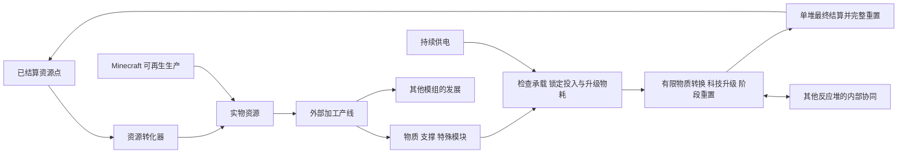

# 闪电科技资源设计方案

[文档首页](../README.md) · [投入与物质转换](投入与物质转换.md) · [运行协同与自动化](运行协同与自动化.md) · [资源转化与来源计价](资源转化与来源计价.md) · [后续设计与原型路线](后续设计与原型路线.md) · [验证与待定事项](验证与待定事项.md) · [增量玩法与两层重置](增量玩法与两层重置.md)

更新：2026-10-30。状态：Minecraft 功能设计草案；已交付独立网页原型。本次细化三类投入、有限物质转换、升级物耗倍率与两层重置，首版测量见[原型数值记录](原型数值记录.md)，游戏内数值仍待验证。

暂定中文名“闪电科技：资源”，定位为独立附属。资源反应堆承载由电力推进、以有限物质转换为基础的策略增量游戏，资源转化器将已经结算的资源点转为实物。玩家通过外部产线准备物质、支撑和特殊模块，安排内部科技升级、加工、协同与结算，再用成果准备后续周目。长期玩法围绕连续多轮的资源产出优化；微型宇宙或物质演化是候选题材，不把猪咪居民养成、返还或文明延续作为当前前置。

本文暂存于 LT Reborn 的 `docs` 分支。首发 Minecraft 版本、加载器、英文名、模组 ID、独立实现仓库及对 AE2、LT、TB 的具体依赖关系待定；不因文档存放位置而将独立附属实现并入 LT，也不将下一代通用多方块框架作为前置。

## 1 设备与职责

| 对象 | 职责 |
| --- | --- |
| 资源反应堆 | 锁定三类轮前实物投入与升级物耗倍率，在有限物质预算下运行科技、加工、阶段重置、跨堆协同及本轮结算 |
| 资源转化器 | 按已解锁来源与确定报价消费资源点，交付对应的实际资源 |
| 外部加工产线 | 通过 Minecraft 生产准备基础资源、压缩物、分级支撑和特殊模块，也可向其他模组供货 |
| 特殊模块 | 解锁本轮特殊加成或能力，暂定一次性；具体效果、消耗节点和叠加方式待定 |
| 自动化模块 | 首次完整通关后可在后续周目开局或很早使用的外部部件，保存策略和玩家脚本，支持连续多轮运行 |
| 内部协同接口 | 在本台本轮发展到相应阶段后解锁，按规则与其他运行中的反应堆交换内部资源或提供实时协同 |

特殊模块、自动化模块和内部协同接口分别处理。特殊模块是本轮投入，可以定义付费加成；自动化模块是持久外部操控设备；内部协同接口属于本轮成长。自动化不提供生产倍率，也不能跳过本轮接口或特殊能力的解锁条件。

既有磁约束球状闪电反应堆负责燃料驱动的 FE、闪电与等离子体生产，与资源反应堆分别设计。大型过载处理工厂、无线网络、相位装备等现有规划不随本附属一并迁移。

## 2 玩家循环

首轮必须存在不依赖资源点的启动路线，允许用正常采集、制作的材料建设基础设备并完成一轮。后续才逐步建立用资源点供应原料的循环，避免“没有点数就无法制造第一台设备或准备第一轮材料”。

目标仍是让外部生产、加工与反应堆组成可持续运行并产生盈余的系统。新方案将物质预算明确绑定到外部投入；单纯“资源点兑换实物后立即投回”的净收益不能沿用旧示例直接认定，应与真实可再生生产、加工、支撑及模块成本分开验证，见[外部经济边界](资源转化与来源计价.md#8-与周目经济的边界)。平衡需同时考虑电力、外部吞吐、投入与策略，不要求每轮手动操作，也不以强制停等作为默认玩法。

## 3 单堆周目与玩家归属

每台资源反应堆拥有独立周目，记录唯一轮次标识、所属玩家、本轮规则与脚本版本、三类投入库存、初始物质量、支撑需求与提供量、开局升级物耗倍率、内部状态、协同解锁和结算记录。

同一玩家可以让不同反应堆处于不同阶段：一台在本轮剩余预算允许时停留在高产或支援阶段，另一台快速发展并反复结算。所有共享有成本，慢堆也不能以有限投入无限成长或无限供给。任何一台的最终结算只重置该台的本轮状态，不清空其他反应堆。机群不采用统一开轮或统一重置。

同一玩家所有同时运行的反应堆共用数量耗电惩罚，跨维度、跨 ME 网络仍统一计算。归属与网络连接分开；首版不通过拆网、换控制者或轮中转让归属规避惩罚。多人团队的共享归属和跨玩家内部协同属于后续规则，不能默认等同于同一玩家。

## 4 轮前投入与轮内边界

### 4.1 备料和启动

玩家或自动化策略选择本轮目标、发展路线和物资清单，允许 ME 或外部物流自动备料。正式启动前可修改清单、撤回实物。

清单分为物质、支撑、特殊模块。每种物质载体提供明确物质量和支撑需求；高级载体牺牲外部原料利用率、提高单位支撑承载的物质量。支撑数量有限、单元分级；启动核对承载条件，以开局支撑提供／需求比经下降型 Sigmoid 确定本轮科技升级物耗倍率。公式、三类投入的作用范围及未定参数见[投入与物质转换](投入与物质转换.md)。

启动时实际扣取实物并归入该堆的本轮专属库存。不得仅检查外部库存数量后把材料复制成可用额度，也不能让多个反应堆共用同一份已经投入的材料。清单不必保证完成最高目标；玩家可以故意选择较低投入的短轮策略。

### 4.2 运行期间

本轮内部科技升级按基础物质成本乘以已锁定的损耗倍率扣费；内部货币、阶段和特殊模块前置分别检查。缺少本轮物质或必要条件时不自动向外补料，不借用下一轮材料。升级倍率不同时扣初始物质量、普通加工和结算奖励。

运行期间允许持续输入 FE 和合法控制指令；FE 推进内部时间，不生成额外物质预算。跨堆接口只接收规则允许且已实际扣减来源的内部资源，不能导入另一台的轮前实物、外部物品、流体或已结算资源点。接收负载不得绕过本轮承载和开局倍率，具体预留方式待原型验证。轮内加工得到的物质同样归本轮持有，不向 Minecraft 物流系统开放提取。

压缩物、支撑和特殊模块可以由外部产线加工而来。默认内容应保留有意义的加工环节；资源转化器的来源目录不因本附属存在就自动开放所有高级组件或任意加工配方。

### 4.3 资源的去向

| 资源或状态 | 本轮期间 | 最终结算后 |
| --- | --- | --- |
| 本轮物质、支撑及其剩余实物 | 仅供本轮使用，不能跨堆搬运 | 全部清空，不返还 |
| 特殊模块及本轮特殊加成 | 暂按一次性投入定义，按各自前置生效 | 加成不跨轮保留，具体消耗节点待定 |
| 轮内产物、内部货币、生产单元、升级、阶段进度 | 按脚本运行，部分内部资源可经合法接口转移 | 本台持有部分全部清空 |
| 本台已解锁的内部协同接口 | 满足运行条件时可使用 | 清空，新一轮重新解锁 |
| 外部机器方块、自动化模块、策略和脚本配置 | 属于外部设备与操作配置 | 保留 |
| 玩家已获得的自动化资格 | 同一玩法下供本人的反应堆使用 | 保留，不随单堆重置清除 |
| 其他反应堆的周目和已合法收到的内部资源 | 由接收堆持有 | 不因来源堆结算而回滚 |
| 已经结算到外部存储的资源点 | 可以兑换、储存和用于外部产线 | 保留 |

“轮末只能带出资源点”约束本轮到外部世界的出口。经已解锁接口进行的轮内虚拟资源协同是独立机制，不允许借接口输出实物，也不返还已转出的资源。转出时必须扣减来源余额，后续不能再把同一份余额用于源堆消费或结算。

## 5 成长与两层重置

内部增量允许出现很大的数值，用于购买生产单元、升级、阶段目标和协同能力，但物质加工、科技升级和共享均受有限预算约束。高级科技提高产物产率的同时也消耗更大数量的基础物质；处理速度与单位物质产额需要分开设计。外部可消费的资源点不与内部货币共用余额或资源身份。

一次外层启动包含多个内部子轮。子轮内以对数生成的科技点支持研究，通过有限可取得点数与深层节点成本形成专精，不设置路线硬互斥。普通设施和升级在内部重置时清除或部分清除，已完成的关键科技可以跨子轮保留；它们在外层最终结算时一并清空，不跨两次外部启动积累。具体规则见[增量玩法与两层重置](增量玩法与两层重置.md)。

| 操作 | 用途 | 是否向外发放资源点 |
| --- | --- | --- |
| 内部子轮重置 | 清除普通成长与子轮科技点，保留关键科技、剩余物质和已生产成果，重新组织发展 | 否 |
| 外层最终结算 | 结束本次投入运行，计算奖励并完整清空本台内部科技、设施与库存 | 是，按当前成果计算，可能很少或为零 |

最终结算不要求完成最高阶段。缺料、达到本轮目标、收益效率下降或玩家准备换路线时，都可以选择提前结算；不把缺料统一视为只能无收益放弃。

自动化可以配置“缺料即结算”，也可以继续完成其他可达目标。某项升级无法支付不应强制结束整轮；结算由玩家或策略明确触发。阶段重置不能恢复已消耗的物质、重发特殊模块或取得更优惠的开局倍率。

“越晚结算奖励越少”必要性较低，暂不设为必需机制。物质耗尽、升级回本、耗电和周转时间已经可以形成停止条件；寿命、熵、维护与退化以后按原型表现再决定。

暂停保留本轮状态，不结算、不退还投入。暂停期间没有内部推进、新产出或实时协同，也不占同时运行台数。欠压运行的退化与主动暂停分别处理，见[供能与退化](运行协同与自动化.md#3-供能不足与退化)。

## 6 资源点奖励

### 6.1 结算依据

流程作者定义物质到可结算成果的转换、科技与阶段前置及奖励上限，覆盖从零进度到完整通关的全部状态。结算界面应能显示当前可领取点数、实际形成的成果和结算后清空的投入。

本次以已支付物质成本的实际转换成果为奖励基础，替代只按历史阶段进度计分的默认建议。阶段、里程碑和挑战可以解锁工艺或定义有界的成果价值，但不能脱离物质预算额外生成无限点数。一般内部货币与天文计数不直接等额兑换；具体成果报价、取整和上限仍待定，奖励必须有效、非负、可存储。开局升级物耗倍率不作为结算回收率再次作用。

早结算按已完成工作给出相应奖励；完成较少时奖励可以很低，完全没有有效进度时允许为零。不设置可被空轮反复领取的固定正数保底。阶段重置和往复触发同一里程碑不能无限叠加奖励。

跨堆支持可以帮助接收堆更快达成条件，但接收堆不能继承来源堆的已完成里程碑、结算资格或整份奖励记录。来源已经转出的物质或成果不能再次纳入来源奖励；真实投入要求、阶段解锁和奖励归属仍按各自周目判断。

### 6.2 奖励上限与产率

单轮奖励有上限，不代表每秒资源点产率已经封顶。高供电、成熟慢堆和自动化可以缩短快堆周目；需要将提前结算和完整通关的收益、轮长、实物与能源成本一起验证。

当前方案不默认增加固定现实时间冷却或玩家每分钟硬限额。若整合包需要严格产率上限，应另行定义，不能把单轮上限当作已经实现的产率保证。

### 6.3 结算与恢复

最终结算先冻结本台状态与协同收发，按固定的本轮规则生成唯一结算记录，再结束该轮并保留待交付资源点。跨堆传输与结算需具有明确先后顺序，不能同时消费或转出同一份资源。

重启、网络断开和输出存储满不重新计算或重复发奖。已结算但未交付的点数继续保存；重复结算指令只读取同一笔结果。下一轮不得覆盖上一轮待交付记录。

拆除控制器不能将轮内库存作为实物掉落，也不能复制周目或形成第二份领奖资格。机器拆装、恢复和主动终止的具体交互待实现设计，但必须保持本轮归属和结算次数一致。

## 7 自动化和外部产线

自动化是长期玩法的基础。首次完整通关让玩家体验本流程的核心机制；此后在新的反应堆周目开局或很早即可使用自动化，把重心转向投入方案、升级顺序、供能分配、快慢堆协同和结算时机的持续优化。

首次完整通关授予玩家可持续使用的自动化资格，不绑定到某一个方块或当前周目。资格、外部模块、脚本和备料清单在结算后保留，内部升级仍需每轮重新付费完成。这样可以连续执行“备料 → 启动 → 升级 → 协同 → 提前或完整结算 → 下一轮”，不会每轮回到必须手动操作至中期或后期的状态。

提前结算仍正常发放对应进度的资源点，但不自动取得“首次完整通关”资格；完整通关条件由流程作者明确配置。它不必要求穷尽所有可选构筑与挑战。已取得的资格对同一存档内该玩家后续反应堆周目有效，不能新放一台机器就要求再手动通关一次。

策略与脚本的能力边界见[自动化设计](运行协同与自动化.md#4-自动化模块)。模块若需要制作，配方与使用条件必须支持通关后在下轮准备阶段取得，不能再次卡到轮中后期。具体配方、开局即可使用还是极早期开放仍待内容设计；不要求玩家必须编程才能实现常见自动化。

资源转化器使用已结算资源点，提供确定投入与确定产出的外部物流能力。其来源、武器、样本、矿物和交易规则见[资源转化与来源计价](资源转化与来源计价.md)。它不参与反应堆的同时运行数量计数，也不直接读取反应堆内部余额。

## 8 永久进度与排行榜候选

明确保留的永久能力是首次完整通关后的自动化资格与操作配置，用于减少重复手动流程。跨存档、跨服务器是否继承尚未决定；先保证同一存档内后续周目的体验。

另外保留绑定正版玩家身份的永久资源与排行榜作为候选扩展，可能用于外观、称号、展示和进一步提前自动化资格。不作为当前反应堆经济或连续自动运行的必要前置，也不在本轮确定其积分来源、消耗或跨服基础设施。

永久资源若加入，应与可兑换实物的资源点完全分开，不可交易或兑换为生产资源。权益不提高产量、奖励、内部速度、接口吞吐、可运行台数，不降低电耗和升级物质成本，也不能通过提高脚本执行额度变相提高机器处理能力。自动化只代替玩家完成合法操作。

提前自动化会减少人工等待，因此可能改善实际游玩吞吐；这不等于直接生产倍率。排行榜若比较效率，需要记录自动化条件，按玩法、规则版本、难度及关键配置区分成绩，不能把任意修改奖励的脚本结果放入同一个公平排行。

永久进度若绑定正版身份，必须使用经可信认证确认的玩家身份，不仅凭可更改的用户名或客户端自报标识。服内保存还是跨服账户服务、身份验证方式、可信成绩来源、榜单指标与赛季规则均待定。本稿不承诺已经具有跨服同步或公共排行榜。

## 9 设计状态

当前确定的主线是：独立附属、反应堆与转化器分工；物质／支撑／特殊模块三类投入；有限数量的分级支撑；高级压缩物以外部原料效率换承载效率；开局 Sigmoid 倍率只作用于科技升级物耗；内部物质转换和共享均有预算与成本。原有按玩家运行数翻倍耗电、暂停不计数、平方根供电加速、独立周目、封闭实物投入、提前结算、完整重置和通关后持久自动化继续保留。

不采用轮中持续向外产点、一般内部余额直接兑点、暂停计入运行数量、机群统一重置或每轮重新手动解锁后期自动化。猪咪居民培养与返还没有进入当前主线；支撑无限堆放的递减方案不作为当前选择。

特殊模块一次性为暂定。物品配方、支撑容量、Sigmoid 参数、科技树、协同接收负载和成果报价需要后续设计；寿命、熵、退化及晚结算损失继续待定。本文不宣称三台或五台最优，也不宣称经济模型通过验证。[后续设计与原型路线](后续设计与原型路线.md)安排下一步，[验证与待定事项](验证与待定事项.md)列出检查范围。
