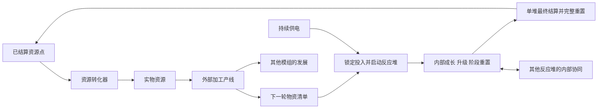

# 闪电科技资源设计方案

[文档首页](../README.md) · [运行协同与自动化](运行协同与自动化.md) · [资源转化与来源计价](资源转化与来源计价.md) · [验证与待定事项](验证与待定事项.md)

日期：2026-10-29。状态：设计草案，尚未实现。

暂定中文名“闪电科技：资源”，定位为独立附属。资源反应堆承载由电力推进的增量游戏，资源转化器将已经结算的资源点转为实物。玩家通过外部产线准备每轮投入，在反应堆内部选择发展与协同策略，最终完整重置单台反应堆的本轮进度并结算资源点。部分收益投入下一轮，盈余用于其他模组的发展。

本文暂存于 LT Reborn 的 `docs` 分支。首发 Minecraft 版本、加载器、英文名、模组 ID、独立实现仓库及对 AE2、LT、TB 的具体依赖关系待定；不因文档存放位置而将独立附属实现并入 LT，也不将下一代通用多方块框架作为前置。

## 1 设备与职责

| 对象 | 职责 |
| --- | --- |
| 资源反应堆 | 接收轮前实物投入和持续供电，运行内部增量、升级、阶段重置、跨堆协同及本轮结算 |
| 资源转化器 | 按已解锁来源与确定报价消费资源点，交付对应的实际资源 |
| 外部加工产线 | 将基础资源加工成升级材料、设备和下轮物资，也可向其他模组供货 |
| 自动化模块 | 首次完整通关后可在后续周目开局或很早使用的外部部件，保存策略和玩家脚本，支持连续多轮运行 |
| 内部协同接口 | 在本台本轮发展到相应阶段后解锁，按规则与其他运行中的反应堆交换内部资源或提供实时协同 |

自动化模块和内部协同接口是不同能力。前者是外部设备，后者属于本轮成长；安装自动化模块不能跳过本轮协同接口的解锁条件。

既有磁约束球状闪电反应堆负责燃料驱动的 FE、闪电与等离子体生产，与资源反应堆分别设计。大型过载处理工厂、无线网络、相位装备等现有规划不随本附属一并迁移。

## 2 玩家循环

首轮必须存在不依赖资源点的启动路线，允许用正常采集、制作的材料建设基础设备并完成一轮。后续才逐步建立用资源点供应原料的循环，避免“没有点数就无法制造第一台设备或准备第一轮材料”。

循环允许持续自给并产生净盈余。平衡目标是让电力、外部加工吞吐、投入选择与内部策略共同影响效率；不要求玩家每轮手动操作，也不以强制停等作为默认玩法。

## 3 单堆周目与玩家归属

每台资源反应堆拥有独立周目，记录唯一轮次标识、所属玩家、本轮脚本版本、投入库存、内部状态、协同解锁和结算记录。

同一玩家可以让不同反应堆处于不同阶段：一台停留在高产阶段持续供给，另一台快速发展并反复结算。任何一台的最终结算只重置该台的本轮状态，不清空其他反应堆。机群不采用统一开轮或统一重置。

同一玩家所有同时运行的反应堆共用数量耗电惩罚，跨维度、跨 ME 网络仍统一计算。归属与网络连接分开；首版不通过拆网、换控制者或轮中转让归属规避惩罚。多人团队的共享归属和跨玩家内部协同属于后续规则，不能默认等同于同一玩家。

## 4 轮前投入与轮内边界

### 4.1 备料和启动

玩家或自动化策略选择本轮目标、发展路线和物资清单，允许 ME 或外部物流自动备料。正式启动前可修改清单、撤回实物。

启动时实际扣取实物并归入该堆的本轮专属库存。不得仅检查外部库存数量后把材料复制成可用额度，也不能让多个反应堆共用同一份已经投入的材料。清单不必保证完成最高目标；玩家可以故意选择较低投入的短轮策略。

### 4.2 运行期间

本轮内部升级同时按规则消耗内部货币与本轮可用实物。具体升级可以有不同投入组合，由流程脚本定义。实物不足时不自动向外补料，不允许借用下一轮材料。

运行期间允许持续输入 FE 和合法控制指令。跨堆接口只接收规则允许的内部增量资源，不能导入另一台的轮前实物、外部物品、流体或已结算资源点来补足本轮实物成本。轮内加工得到的物质同样归本轮持有，不向 Minecraft 物流系统开放提取。

升级材料可以由外部产线加工而来。默认内容应保留有意义的加工环节；资源转化器的来源目录不因本附属存在就自动开放所有高级组件或任意加工配方。

### 4.3 资源的去向

| 资源或状态 | 本轮期间 | 最终结算后 |
| --- | --- | --- |
| 本轮投入的实物及剩余量 | 仅供本轮使用，不能跨堆搬运 | 全部清空，不返还 |
| 轮内产物、内部货币、生产单元、升级、阶段进度 | 按脚本运行，部分内部资源可经合法接口转移 | 本台持有部分全部清空 |
| 本台已解锁的内部协同接口 | 满足运行条件时可使用 | 清空，新一轮重新解锁 |
| 外部机器方块、自动化模块、策略和脚本配置 | 属于外部设备与操作配置 | 保留 |
| 玩家已获得的自动化资格 | 同一玩法下供本人的反应堆使用 | 保留，不随单堆重置清除 |
| 其他反应堆的周目和已合法收到的内部资源 | 由接收堆持有 | 不因来源堆结算而回滚 |
| 已经结算到外部存储的资源点 | 可以兑换、储存和用于外部产线 | 保留 |

“轮末只能带出资源点”约束本轮到外部世界的出口。经已解锁接口进行的轮内虚拟资源协同是独立机制，不允许借接口输出实物，也不返还已转出的资源。转出时必须扣减来源余额，后续不能再把同一份余额用于源堆消费或结算。

## 5 成长与两类重置

内部增量允许出现很大的数值，用于购买生产单元、升级、阶段目标和协同能力。外部可消费的资源点不与内部货币共用余额或资源身份。

| 操作 | 用途 | 是否向外发放资源点 |
| --- | --- | --- |
| 阶段重置 | 按流程脚本清除部分状态、解锁新的内部成长 | 否 |
| 最终结算 | 结束当前周目，计算奖励并完整清空本台轮内状态 | 是，按当前成果计算，可能很少或为零 |

最终结算不要求完成最高阶段。缺料、达到本轮目标、收益效率下降或玩家准备换路线时，都可以选择提前结算；不把缺料统一视为只能无收益放弃。

自动化可以配置“缺料即结算”，也可以继续完成其他可达目标。缺少某一项升级材料不应强制结束整轮；结算由玩家或策略明确触发。

暂停保留本轮状态，不结算、不退还投入。暂停期间没有内部推进、新产出或实时协同，也不占同时运行台数。欠压运行的退化与主动暂停分别处理，见[供能与退化](运行协同与自动化.md#3-供能不足与退化)。

## 6 资源点奖励

### 6.1 结算依据

流程作者定义阶段、里程碑、挑战条件与奖励函数，覆盖从零进度到完整通关的全部状态。结算界面应能显示当前可领取点数、已满足的条件和结算后清空的投入。

建议采用有界的阶段进度奖励与挑战加成。内部天文数字主要用于满足条件，也可以提供封顶加成，不按内部余额直接等额兑换。奖励计算必须返回有效、非负、可存储的数量，并服从该流程版本的单轮奖励上限。

早结算按已完成工作给出相应奖励；完成较少时奖励可以很低，完全没有有效进度时允许为零。不设置可被空轮反复领取的固定正数保底。阶段重置和往复触发同一里程碑不能无限叠加奖励。

跨堆支持可以帮助接收堆更快达成条件，但接收堆不能继承来源堆的已完成里程碑、结算资格或整份奖励记录。真实投入要求、阶段解锁和奖励归属仍按各自周目判断。

### 6.2 奖励上限与产率

单轮奖励有上限，不代表每秒资源点产率已经封顶。高供电、成熟慢堆和自动化可以缩短快堆周目；需要将提前结算和完整通关的收益、轮长、实物与能源成本一起验证。

当前方案不默认增加固定现实时间冷却或玩家每分钟硬限额。若整合包需要严格产率上限，应另行定义，不能把单轮上限当作已经实现的产率保证。

### 6.3 结算与恢复

最终结算先冻结本台状态与协同收发，按固定的本轮规则生成唯一结算记录，再结束该轮并保留待交付资源点。跨堆传输与结算需具有明确先后顺序，不能同时消费或转出同一份资源。

重启、网络断开和输出存储满不重新计算或重复发奖。已结算但未交付的点数继续保存；重复结算指令只读取同一笔结果。下一轮不得覆盖上一轮待交付记录。

拆除控制器不能将轮内库存作为实物掉落，也不能复制周目或形成第二份领奖资格。机器拆装、恢复和主动终止的具体交互待实现设计，但必须保持本轮归属和结算次数一致。

## 7 自动化和外部产线

自动化是长期玩法的基础。首次完整通关让玩家体验本流程的核心机制；此后在新的反应堆周目开局或很早即可使用自动化，把重心转向投入方案、升级顺序、供能分配、快慢堆协同和结算时机的持续优化。

首次完整通关授予玩家可持续使用的自动化资格，不绑定到某一个方块或当前周目。资格、外部模块、脚本和备料清单在结算后保留，内部升级仍需每轮重新付费完成。这样可以连续执行“备料 → 启动 → 升级 → 协同 → 提前或完整结算 → 下一轮”，不会每轮回到必须手动操作至中期或后期的状态。

提前结算仍正常发放对应进度的资源点，但不自动取得“首次完整通关”资格；完整通关条件由流程作者明确配置。它不必要求穷尽所有可选构筑与挑战。已取得的资格对同一存档内该玩家后续反应堆周目有效，不能新放一台机器就要求再手动通关一次。

策略与脚本的能力边界见[自动化设计](运行协同与自动化.md#4-自动化模块)。模块若需要制作，配方与使用条件必须支持通关后在下轮准备阶段取得，不能再次卡到轮中后期。具体配方、开局即可使用还是极早期开放仍待内容设计；不要求玩家必须编程才能实现常见自动化。

资源转化器使用已结算资源点，提供确定投入与确定产出的外部物流能力。其来源、武器、样本、矿物和交易规则见[资源转化与来源计价](资源转化与来源计价.md)。它不参与反应堆的同时运行数量计数，也不直接读取反应堆内部余额。

## 8 永久进度与排行榜候选

明确保留的永久能力是首次完整通关后的自动化资格与操作配置，用于减少重复手动流程。跨存档、跨服务器是否继承尚未决定；先保证同一存档内后续周目的体验。

另外保留绑定正版玩家身份的永久资源与排行榜作为候选扩展，可能用于外观、称号、展示和进一步提前自动化资格。不作为当前反应堆经济或连续自动运行的必要前置，也不在本轮确定其积分来源、消耗或跨服基础设施。

永久资源若加入，应与可兑换实物的资源点完全分开，不可交易或兑换为生产资源。权益不提高产量、奖励、内部速度、接口吞吐、可运行台数，不降低电耗和升级实物成本，也不能通过提高脚本执行额度变相提高机器处理能力。自动化只代替玩家完成合法操作。

提前自动化会减少人工等待，因此可能改善实际游玩吞吐；这不等于直接生产倍率。排行榜若比较效率，需要记录自动化条件，按玩法、规则版本、难度及关键配置区分成绩，不能把任意修改奖励的脚本结果放入同一个公平排行。

永久进度若绑定正版身份，必须使用经可信认证确认的玩家身份，不仅凭可更改的用户名或客户端自报标识。服内保存还是跨服账户服务、身份验证方式、可信成绩来源、榜单指标与赛季规则均待定。本稿不承诺已经具有跨服同步或公共排行榜。

## 9 设计状态

当前确定的主线是：独立附属、反应堆与转化器分工、按玩家同时运行数翻倍耗电、暂停不占数量、平方根供电加速、多机错峰协同、轮前实物锁定、轮中封闭实物投入、单堆可提前最终结算、轮内状态完整清空，以及首次完整通关后在后续周目很早使用并持续保留的自动化。

前期讨论中的持续产点、直接把内部余额换成资源点、暂停也占运行数量、机群统一重置以及每轮重新手动推进到中后期才开放自动化不采用。

具体增量阶段、生产单元、协同资源、奖励曲线、实物清单、供能参数与退化数值需要后续设计和仿真。本文不宣称三台或五台已经达到最优，也不宣称当前经济模型已经通过长时间运行验证。[验证与待定事项](验证与待定事项.md)列出后续检查范围。
